RESEARCH REPORT

# DAPO cho SlideGen: model mở tự dựng slide ít lỗi hiển thị hơn

Học tăng cường cho Qwen3.5-35B-A3B gọi công cụ XML dựng slide tiếng Việt, với reward kiểm chứng bằng ảnh thật và người chấm

SlideGen · bản 3 · 21/10/2026

---

## Mục lục

01 · Tóm tắt một trang
02 · Bài toán và hệ thống
03 · Bước 1: dữ liệu cặp đẹp–xấu và reward thẩm mỹ
04 · Bước 2: DAPO vòng 1 và đợt chấm người đầu tiên
05 · Bước 3: lỗi "của model" hóa ra là lỗi môi trường
06 · Bước 4: hiệu chỉnh reward bằng người chấm, và các lần thử thất bại
07 · Bước 5: vòng 4, model học tóm gọn thay vì thu nhỏ chữ
08 · Bước 6: xem ảnh để vá các chỗ reward bị lừa
09 · Bước 7: tập test giữ riêng, so với model gốc và Gemini
10 · Bước 8: chấm người đợt 2 (kết quả tạm)
11 · Kết luận và việc tiếp theo
12 · Phụ lục

---

## 01 · Tóm tắt một trang

**Câu hỏi.** Học tăng cường (DAPO) có giúp một model mở cỡ vừa tự dựng slide tiếng Việt ít lỗi hơn không, và phần cải thiện đến từ RL hay từ việc sửa môi trường?

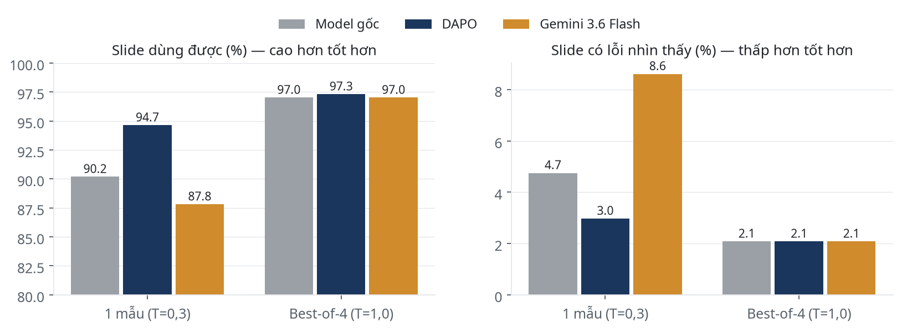

| Con số chính | Model gốc | DAPO (bản chốt) | Gemini 3.5 Flash |
|---|---|---|---|
| Slide dùng được, tập test, 1 mẫu | 90,2% | **94,7%** | 87,8% |
| Slide có lỗi nhìn thấy, tập test, 1 mẫu | 4,7% | **3,0%** | 8,6% |
| Độ phủ ý chính (keypoint), tập test | **0,811** | 0,788 | 0,778 |
| Slide dùng được, tập test, best-of-4 | 97,0% | 97,3% | 97,0% |
| Lỗi nhìn thấy, tập phát triển, 3 seed | 7,6% | 4,6% ± 0,7 | n/a |

**Kết luận chính**

1. **DAPO giảm lỗi hiển thị, và lặp lại được qua 3 seed.** Lỗi nhìn thấy giảm gần một nửa trên tập phát triển, và từ 4,7% xuống 3,0% trên tập test chưa từng dùng.
2. **Cái giá là nội dung ngắn hơn.** Keypoint giảm khoảng 0,02, vì model học tóm gọn để vừa layout chứ không thu nhỏ chữ.
3. **RL chưa nâng trần chất lượng.** Model gốc sinh 4 mẫu rồi để reward chọn thì đạt cùng mức với DAPO (97,0% so với 97,3%). Giá trị của RL là đạt chất lượng đó chỉ với 1 mẫu, rẻ hơn 4 lần khi suy luận.
4. **Một mẫu, DAPO hơn Gemini 3.5 Flash về lỗi hiển thị**: 3,0% so với 8,6%. Lỗi của Gemini gồm gãy chữ, lộ ký hiệu Markdown và để nguyên chữ mẫu tiếng Anh.
5. **Phần lớn cải thiện đến từ việc sửa môi trường và reward.** Riêng việc sửa môi trường, chưa train, đã giảm số liệu bịa của model gốc từ 11,7% xuống 1,5%.
6. **Người chấm chưa phân biệt được DAPO với các hệ thống khác.** Theo kết quả tạm của đợt 2 (2/3 người, 651 lượt), tỉ lệ thắng tổng thể quanh 0,5 ở cả ba so sánh, và phần lớn cặp được chấm hòa.

---

## 02 · Bài toán và hệ thống

Model nhận nội dung một slide (đoạn trích tài liệu nguồn, layout được gán, gợi ý sức chứa) rồi sinh **đúng một lời gọi công cụ XML**. Công cụ dựng slide, trình duyệt render ra ảnh, và reward chấm ảnh cùng nội dung.

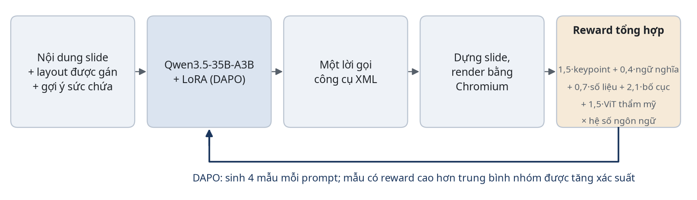

**Ba khái niệm dùng suốt báo cáo**

| Khái niệm | Định nghĩa |
|---|---|
| Hợp lệ | Lời gọi công cụ phân tích được và công cụ chạy được |
| Lỗi nhìn thấy | Chữ bị cắt, chữ khó đọc trên nền, khối đè nhau, lộ ký hiệu, vượt mép slide, chữ quá nhỏ, chữ tràn khỏi nền hoặc panel |
| **Dùng được (chỉ số chính)** | Hợp lệ và không có lỗi nhìn thấy |

> **Vấn đề cốt lõi.** Không ai chấm tay được hàng chục nghìn slide trong lúc train, nên reward phải tự động. Mà reward tự động thì bị model khai thác đúng ở những chỗ nó đo sai. Mọi bước trong báo cáo là một vòng lặp: đo, xem ảnh thật, tìm chỗ đo sai, sửa.

**Dữ liệu**

| Tập | Nguồn | Quy mô | Dùng để |
|---|---|---|---|
| Train RL | 44 bộ slide dựng sẵn, khoảng 18 chủ đề | 370 prompt | Train DAPO |
| Eval lúc train | Cùng phân phối với tập train | 168 slide × 4 mẫu | Early stopping |
| Tập phát triển | 38 bài Wikipedia tiếng Việt, chủ đề mới | 291 slide | Chọn checkpoint, đo seed |
| **Tập test giữ riêng** | 44 bài Wikipedia khác, chủ đề không trùng hai tập trên | 337 slide | Chạy đúng một lần cho bản chốt |
| Người chấm đợt 1 | Trang so cặp mù, 3 người | 1.281 lượt, 595 cặp | Kiểm chứng reward |
| Người chấm đợt 2 | Cùng trang và giao thức, trên tập test | 666 cặp (đang chấm) | Kiểm chứng kết luận cuối |

**Cấu hình.**
- Model: Qwen3.5-35B-A3B (35B tham số, khoảng 3B kích hoạt mỗi token), QLoRA NF4, LoRA r=16.
- Thuật toán: DAPO qua TRL `GRPOTrainer`, 4 mẫu mỗi prompt, LR 1e-5, early stopping theo reward eval.

---

## 03 · Bước 1: dữ liệu cặp đẹp–xấu và reward thẩm mỹ

**Kết luận: một ViT nhỏ train trên 1.929 cặp gán tay chọn đúng slide đẹp 97,9%, ngang một VLM 35B. Nhưng trên slide do model sinh, nó chỉ khớp người 60%.**

Không có bộ dữ liệu slide nào gán nhãn thẩm mỹ theo loại lỗi, còn LLM lớn thì chấm quá chậm cho RL. Vì vậy chúng tôi tự dựng 1.929 cặp, mỗi cặp gồm một slide đẹp và một bản xấu của chính nó mang một hoặc hai lỗi cụ thể.

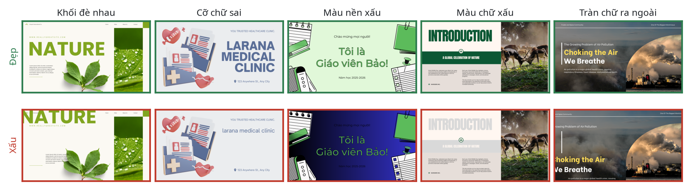

- 5 loại lỗi, 18 tổ hợp lỗi đơn và kép, 1.805 slide gốc, 5 người làm.
- Chia tập theo slide gốc: 1.736 cặp train và 193 cặp kiểm thử, không slide gốc nào nằm ở cả hai tập.
- ViT-Base train kiểu so cặp (loss Bradley–Terry); reward thẩm mỹ là sigmoid của điểm.

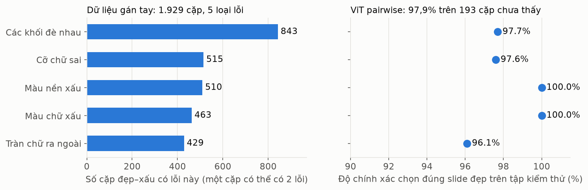

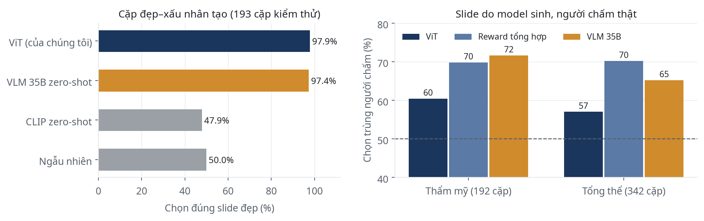

> **Ý rút ra.** Bộ cặp cho nhãn chắc chắn và đủ để train một reward nhỏ, nhanh. Nhưng nó không phải benchmark khó: VLM lớn không train đã đạt 97,4%. Lỗi trên slide do model sinh tinh tế hơn lỗi gán tay, nên thẩm mỹ chỉ là một thành phần của reward tổng hợp.

---

## 04 · Bước 2: DAPO vòng 1 và đợt chấm người đầu tiên

**Kết luận: DAPO vòng 1 thắng model gốc khi người chấm, nhưng thua Gemini và thua best-of-8.**

- **Reward tổng hợp** gồm nội dung (từ vựng, ngữ nghĩa, giữ đúng số liệu), bố cục đo trong trình duyệt và ViT thẩm mỹ, nhân với hệ số đúng ngôn ngữ; lời gọi hỏng bị −2.
- **Tăng tốc train 2,7 lần** (166 → 60 giây mỗi bước) nhờ kernel flash-linear-attention và causal-conv1d, nên chạy được hơn 10 lần thử.
- **Ba người chấm so mù 595 cặp** trên tập phát triển.

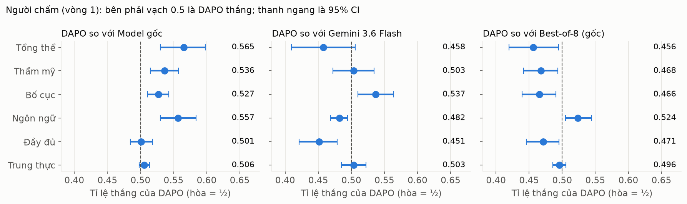

- **DAPO thắng model gốc 0,565** [0,530; 0,598]. Lỗi sai ngôn ngữ người đánh dấu giảm từ 11,9% xuống 3,6%.
- **DAPO thua Gemini (0,458) và best-of-8 (0,456).**
- **Reward chọn trùng người 70,6%**, và càng khớp khi hai slide chênh nhau nhiều:

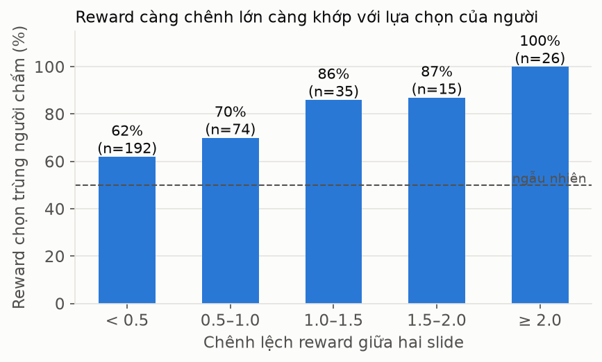

> **Ý rút ra.** Reward có nghĩa nhưng thiếu tín hiệu. Người chấm phàn nàn nhiều nhất về chữ khó đọc trên nền và chữ tràn viền, đúng hai lỗi reward không đo.

---

## 05 · Bước 3: lỗi "của model" hóa ra là lỗi môi trường

**Kết luận: ba lần liên tiếp, lỗi tưởng do model hóa ra do công cụ, prompt hoặc bước áp style.**

| Lỗi | Nguyên nhân thật |
|---|---|
| Số liệu bịa | Công cụ slide cảm ơn tự điền số điện thoại, email mẫu khi model để trống; công cụ biểu đồ có số liệu mẫu mặc định |
| JSON hỏng | Một gợi ý trong prompt làm hỏng ký tự thoát JSON |
| Chữ khó đọc | Model chọn màu đúng, nhưng bước áp style ghi đè màu tiêu đề bằng màu dải nền. Pipeline thật có bước sửa tương phản, còn đường train và đường chấm thì bỏ qua |

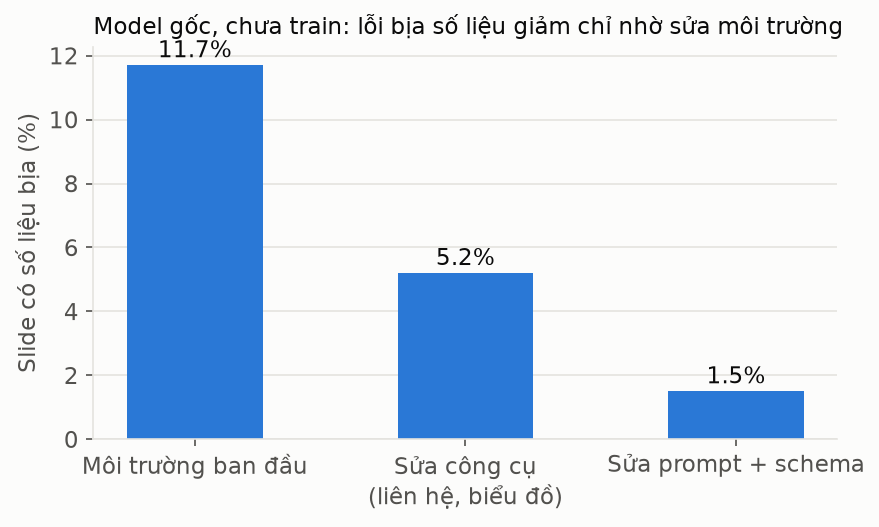

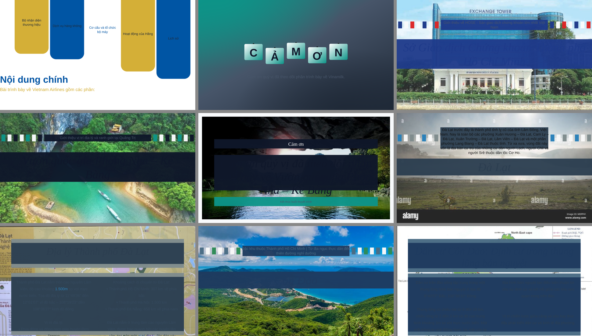

- **Nối thêm bước sửa tương phản:** slide có chữ khó đọc của model gốc giảm từ 17,7% xuống 0,4%.
- **Thêm hai phép đo** `low_contrast` (trên pixel nền thật) và `text_cutoff`: bộ đo bố cục bắt được 185/190 slide người đánh dấu lỗi hiển thị, trước đó chỉ 138/190.

> **Ý rút ra.** Với RL gọi công cụ, phải kiểm tra môi trường train khớp với pipeline thật trước khi tin reward. Nếu không, RL phạt model vì thứ nó không điều khiển được.

---

## 06 · Bước 4: hiệu chỉnh reward bằng người chấm, và các lần thử thất bại

**Kết luận: dữ liệu người chấm cho trọng số lỗi bố cục và một thành phần nội dung tốt hơn. Phần lớn các thay đổi khác không qua được tập phát triển.**

- **Trọng số lỗi bố cục theo người:** lấy từ 342 cặp người chấm có kết quả rõ (820 slide). Lỗi người xác nhận 73–90% thì xóa toàn bộ điểm bố cục; tràn chiều cao khung chỉ phạt 0,25; lỗi người không bao giờ đánh dấu thì bỏ phạt.
- **Độ phủ ý chính (keypoint):** đo từng câu nguồn có được thể hiện trên slide không. Khớp người ở tiêu chí đầy đủ 70,6%, hơn trùng từ vựng (65,0%) và ngữ nghĩa cả slide (62,3%).
- **Gợi ý sức chứa đo bằng chính layout:** chạy công cụ với chữ mẫu, tìm số ký tự dài nhất không tràn cho từng trường.

**Kết quả âm (giữ lại để không lặp lại):**

| Thử | Kết quả | Vì sao bỏ |
|---|---|---|
| Thêm câu "không bịa số liệu" vào prompt | Không đổi tỉ lệ bịa | Lỗi bịa chủ yếu do môi trường |
| Nhắc escape dấu nháy JSON trong prompt | Không đổi tỉ lệ hợp lệ | Chuyển sang sửa ở bộ phân tích |
| Vòng 2e: train tiếp từ 2d | Không hồi được độ phủ nội dung | Quay về LoRA mới |
| Tự co chữ ở layout | Lỗi nhìn thấy của model gốc 8,2% → 3,8% | Bỏ theo yêu cầu sản phẩm: cỡ chữ phải đồng nhất |
| Đo độ chen chữ giữa hai hộp | 78/262 slide sát nhau dưới 1 px, phần lớn bình thường | Không tách được slide lỗi |

> **Ý rút ra.** Thay đổi nào không qua được tập phát triển ở nhiệt độ 0,3 thì không đáng một lần train 6 giờ trên H100.

---

## 07 · Bước 5: vòng 4, model học tóm gọn thay vì thu nhỏ chữ

**Kết luận: vòng 4 giảm lỗi nhìn thấy gần một nửa và lặp lại được trên 3 seed. Đổi lại, độ phủ ý chính giảm 0,02.**

- **Reward:** 1,5·keypoint + 0,4·ngữ nghĩa + 0,7·số liệu + 2,1·bố cục + 1,5·ViT, nhân hệ số ngôn ngữ. Không tự co chữ.
- **Cổng chọn bản chốt** (trên tập phát triển): hợp lệ ≥ 98%, dùng được ≥ 95%, lỗi nhìn thấy ≤ 4%, keypoint không thấp hơn gốc quá 0,03.
- **Bản chốt:** seed 42, bước 175. Hai seed lặp lại (7 và 2026) chạy trên đúng code đó.

**Các cấu hình so sánh trong Hình 11.** Tất cả đều là cùng model Qwen3.5-35B-A3B, train DAPO trên cùng 370 prompt; chỉ reward và môi trường khác nhau. Mọi hệ thống được đánh giá lại với cùng prompt vòng 4 và cùng bộ kiểm tra.

| Cấu hình | Reward nội dung | Phạt lỗi bố cục | Tự co chữ | Seed | Kết quả |
|---|---|---|---|---|---|
| Model gốc | (không train) | n/a | n/a | n/a | Mốc so sánh |
| DAPO-2d | Trùng từ vựng 0,5 + ngữ nghĩa 0,7 | Phạt từng lỗi một phần (cắt chữ 0,40; đè khối 0,30; tràn chiều cao 0,03…) | Bật | 42 | Ít lỗi, nhưng viết ngắn: keypoint thấp hơn gốc 0,031 |
| DAPO-3 | Như 2d | Theo người chấm đợt 1: lỗi người thấy được mất toàn bộ điểm bố cục; tràn chiều cao mất 1/4 | Bật | 42 | Thất bại: lỗi nhìn thấy 8,9%, cao hơn cả gốc |
| **DAPO-4** | **Keypoint 1,5** + ngữ nghĩa 0,4 (bỏ trùng từ vựng) | Như vòng 3 | **Tắt** (cỡ chữ cố định) | 42, 7, 2026 | Qua cổng; bản chốt là seed 42 |

Vòng 4 cũng bắt đầu từ LoRA mới (không train tiếp vòng trước) và dùng gợi ý sức chứa v2 (đo đồng thời mọi trường, kèm số mục tối đa).

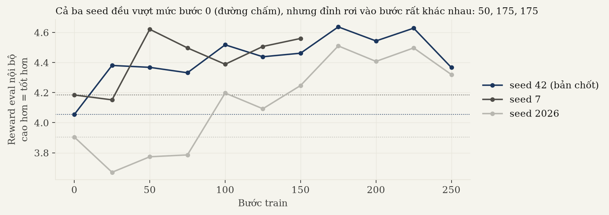

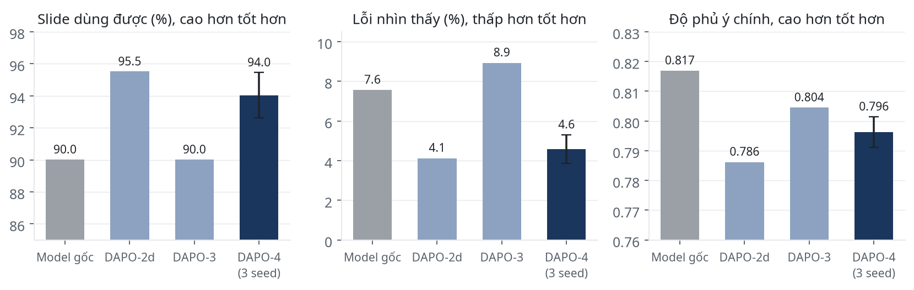

- **Chỉ bản chốt qua đủ cổng:** dùng được 95,2%, lỗi nhìn thấy 3,8%, keypoint 0,791 (gốc 0,817). DAPO-2d hụt sát (keypoint thấp hơn gốc 0,031); DAPO-3 hụt xa (lỗi nhìn thấy 8,9%).
- **Chữ bị cắt giảm từ 2,7% xuống 1,0% ± 0,3.** Model tóm gọn nội dung để vừa khung thay vì làm chữ nhỏ đi.
- **Ở T=0,3, slide bìa và mục lục gần như giống hệt model gốc;** khác biệt nằm ở slide nhiều chữ.

---

## 08 · Bước 6: xem ảnh để vá các chỗ reward bị lừa

**Kết luận: năm loại lỗi có reward cao trong khi slide hỏng rõ ràng, và chỉ xem ảnh mới thấy.**

| Lỗi thấy trong ảnh | Ví dụ | Kiểm tra báo nhầm |
|---|---|---|
| Chữ có dấu bị hỏng | *"Cùng H Fle Ph^\i^^i^^n Kh^^o^^a"*, reward 5,16 | 0 ca nhầm trên 17.620 slide |
| Chữ ngoại lai | *"Xuất khẩu خام Sang Tạo"*, *"trực tiếp指挥"* | Chỉ tính khi nguồn không có chữ đó |
| Thẻ HTML lọt | *"<Vị đậm đà"*, `<math-field>` | Mọi ca trên khoảng 15.000 slide là lỗi thật |
| Chữ tràn khỏi nền hoặc panel | Tiêu đề cảm ơn tràn xuống ảnh tối | Xác nhận bằng pixel hai bên mép; bản chỉ đo DOM báo nhầm khoảng một nửa |
| JSON hỏng vì dấu nháy lồng | *"Chiến dịch "nói không với rác thải nhựa""* | Dữ liệu đúng không đổi (51/51) |

- Sửa dấu nháy JSON đưa tỉ lệ hợp lệ của model gốc từ 97,9% lên 99,3% trên tập phát triển.
- Ở T=0,3, chữ ngoại lai, chữ hỏng và thẻ lọt đều bằng 0 ở mọi hệ thống; chúng chỉ xuất hiện khi lấy mẫu ở T=1,0 lúc train (khoảng 1%).

> **Ý rút ra.** Mọi bộ phát hiện phải được kiểm tra báo nhầm bằng ảnh trước khi đưa vào reward.

---

## 09 · Bước 7: tập test giữ riêng, so với model gốc và Gemini

**Kết luận: trên dữ liệu chưa từng dùng, DAPO một mẫu có ít lỗi nhất. Nhưng best-of-4 của bất kỳ hệ thống nào cũng làm được như vậy.**

Cả ba hệ thống chạy đúng một lần trên 337 slide, cùng prompt vòng 4 (có gợi ý sức chứa), cùng bộ kiểm tra, cùng môi trường render. Có hai cấu hình: 1 mẫu ở T=0,3 (cách dùng thật) và 4 mẫu ở T=1,0 rồi để reward chọn (best-of-4).

| Hệ thống (337 slide) | Hợp lệ | **Dùng được** | Lỗi nhìn thấy | Chữ bị cắt | Tràn khung | Keypoint | Số liệu |
|---|---|---|---|---|---|---|---|
| Model gốc, 1 mẫu | 95,0% | 90,2% | 4,7% | 1,5% | 3,0% | 0,811 | 0,826 |
| **DAPO, 1 mẫu** | **97,6%** | **94,7%** | **3,0%** | 0,6% | 1,8% | 0,788 | 0,798 |
| Gemini 3.5 Flash, 1 mẫu | 96,4% | 87,8% | 8,6% | 0,6% | 6,5% | 0,778 | 0,816 |
| Model gốc, best-of-4 | 99,1% | 97,0% | 2,1% | 0,6% | 0,6% | 0,813 | 0,854 |
| DAPO, best-of-4 | 99,4% | 97,3% | 2,1% | 0,6% | 0,9% | 0,815 | 0,854 |
| Gemini, best-of-4 | 99,1% | 97,0% | 2,1% | 0,9% | 0,9% | 0,826 | 0,861 |

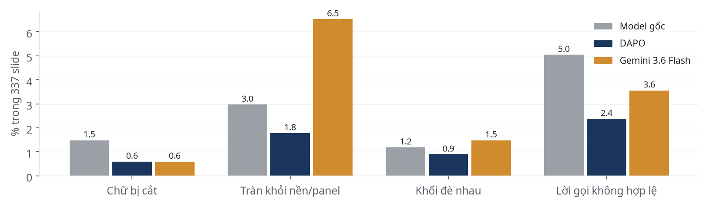

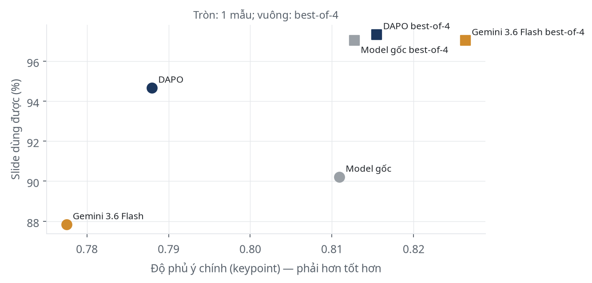

### DAPO sửa được gì so với model gốc

18 slide chỉ model gốc lỗi, so với 3 slide chỉ DAPO lỗi.

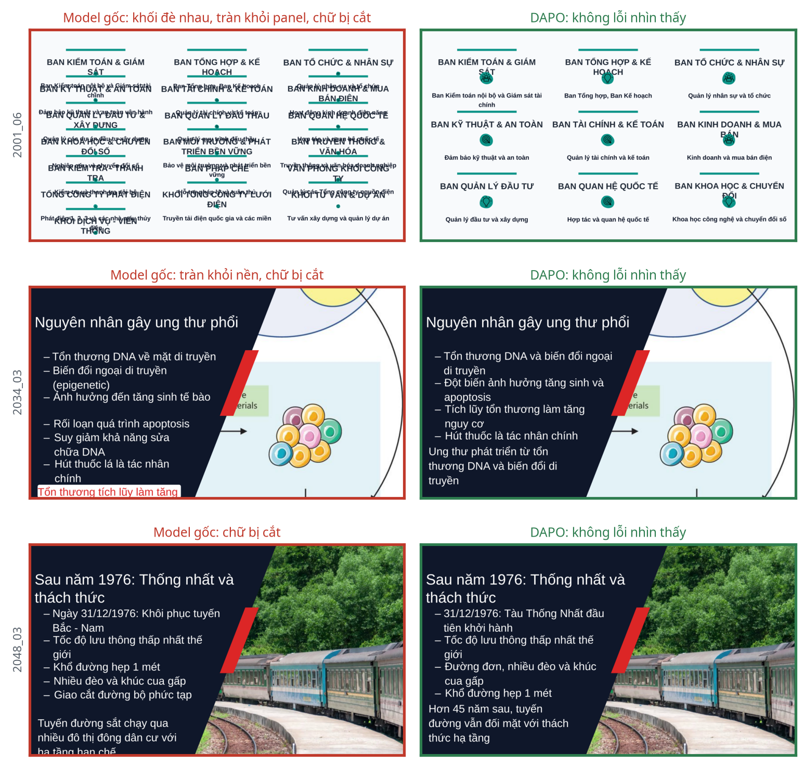

### Lỗi của Gemini 3.5 Flash

48 slide chỉ Gemini lỗi, so với 13 slide chỉ DAPO lỗi.

- 15 slide của Gemini bị trừ điểm ngôn ngữ vì lẫn chữ tiếng Anh, như chữ mẫu "Add instruction text for this platform" (DAPO: 3 slide, model gốc: 3 slide).
- 12 slide Gemini không hợp lệ: 8 slide vượt giới hạn số từ ghi rõ trong mô tả công cụ, 4 slide sai ràng buộc khác.
- Có gợi ý sức chứa, Gemini hết cắt chữ (từ 15,8% trên tập phát triển với prompt cũ xuống 0,6%), nhưng viết ngắn lại: keypoint 0,778, thấp hơn cả DAPO.

### DAPO vẫn còn lỗi

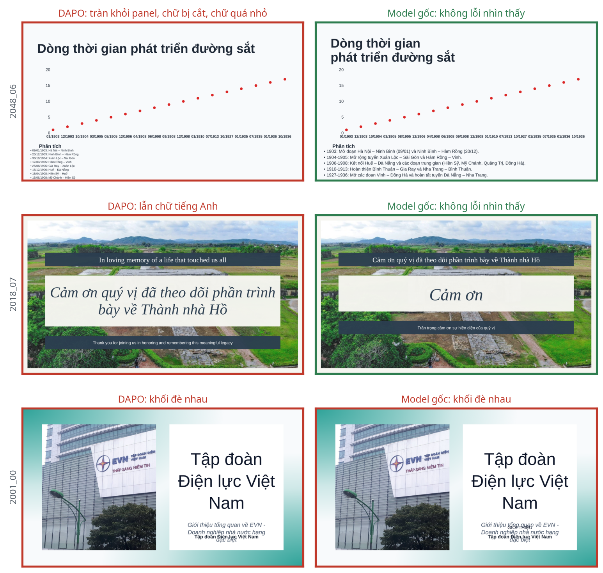

- 8 slide DAPO không hợp lệ, 7 trong số đó do vượt số mục tối đa của layout (ví dụ 13 thẻ cho layout 3 thẻ). Model gốc mắc lỗi này với tần suất tương đương.
- Lỗi slide bìa đè phụ đề (2001_00) do layout tự sinh, xuất hiện ở mọi hệ thống.

> **Ý rút ra.** RL chuyển phần chất lượng của việc lọc 4 mẫu vào một mẫu duy nhất (rẻ hơn 4 lần khi suy luận), chứ không nâng trần chất lượng.

---

## 10 · Bước 8: chấm người đợt 2 (kết quả tạm)

**Kết luận tạm: người chấm chưa phân biệt được DAPO với model gốc, với best-of-4 hay với Gemini ở tiêu chí tổng thể. Phần lớn cặp được chấm hòa.**

Giao thức giữ y như đợt 1: chấm mù, xáo vị trí A/B, 6 tiêu chí (có lựa chọn "ngang nhau"), mỗi cặp 2 người, 15% cặp cả 3 người, 5% cặp lặp lại để kiểm tra chú ý. Slide lấy từ tập test giữ riêng, với các hệ thống ở mục 09.

**Tiến độ tại thời điểm báo cáo:** A1 xong 480/480, A2 197/478, A3 chưa bắt đầu. Tổng cộng 651 lượt chấm, chưa tính cặp kiểm tra chú ý.

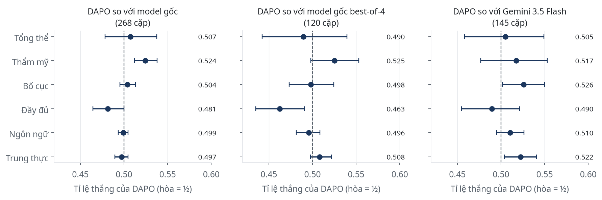

| So sánh (tiêu chí tổng thể) | Cặp | DAPO thắng | Hòa | DAPO thua | Tỉ lệ thắng [95% CI] |
|---|---|---|---|---|---|
| DAPO vs model gốc | 268 | 31 | 206 (77%) | 31 | 0,507 [0,478; 0,537] |
| DAPO vs model gốc best-of-4 | 120 | 19 | 76 (63%) | 25 | 0,490 [0,442; 0,539] |
| DAPO vs Gemini 3.5 Flash | 145 | 33 | 77 (53%) | 35 | 0,505 [0,458; 0,549] |

- **Thẩm mỹ là tiêu chí duy nhất DAPO hơn model gốc có ý nghĩa:** 0,524 [0,512; 0,538].
- **Độ đầy đủ DAPO hơi kém:** 0,481 so với model gốc, 0,463 so với best-of-4. Khớp với keypoint giảm 0,02 đo tự động.
- **So với Gemini, DAPO hơn về bố cục (0,526) và trung thực (0,522):** người chấm đánh dấu Gemini bịa thông tin ở 2,3% lượt, lỗi hiển thị nghiêm trọng 3,5%, sai ngôn ngữ 2,3%; DAPO lần lượt 0%, 1,4%, 0,6%.
- **Độ đồng thuận** (Krippendorff alpha) cao nhất ở bố cục (0,62), thấp ở tổng thể (0,22) và thẩm mỹ (0,18).

> **Lưu ý.** Đây là kết quả tạm: mới 2/3 người chấm, phần lớn cặp chỉ có một người, và A2 mới làm 2 cặp kiểm tra chú ý (A1 đạt 22/24). Kết luận cuối chờ A2 và A3 chấm xong.

---

## 11 · Kết luận và việc tiếp theo

**DAPO giảm lỗi hiển thị một cách lặp lại được, nhưng phần lớn chất lượng đến từ việc sửa môi trường và reward. Người xem chưa thấy khác biệt.**

1. Dữ liệu 1.929 cặp đẹp–xấu cho reward thẩm mỹ nhỏ, nhanh, chính xác 97,9%. Tuy vậy, tập kiểm thử của nó quá dễ để làm benchmark cho model lớn, và trên slide thật reward này chỉ khớp người 60%.
2. DAPO giảm lỗi nhìn thấy: tập phát triển 7,6% → 4,6% ± 0,7 (3 seed), tập test 4,7% → 3,0%.
3. Đánh đổi là keypoint giảm khoảng 0,02, và người chấm đợt 2 cũng thấy DAPO kém đầy đủ hơn một chút.
4. Best-of-4 của model gốc ngang DAPO best-of-4: giá trị của RL là giảm chi phí suy luận, không phải nâng trần.
5. Một mẫu, DAPO ít lỗi hơn Gemini 3.5 Flash cùng prompt (3,0% so với 8,6%), nhưng người chấm tạm thời coi hai bên ngang nhau ở tiêu chí tổng thể.
6. Ba lần lỗi môi trường và năm chỗ reward chấm sai đều chỉ lộ ra khi bóc tách từng slide và xem ảnh.

**Việc tiếp theo**

1. Hoàn tất chấm người đợt 2 (A2, A3), rồi chốt kết luận về sở thích người.
2. Phạt thẩm mỹ thấp bằng phép nhân thay vì cộng. Ví dụ: slide cảm ơn ghép 18 ô chữ nhỏ có ViT 0,07 nhưng reward tổng 5,04, cao hơn bản gọn 5 ô (4,94).
3. Sửa layout bìa và layout cảm ơn đang tự sinh lỗi ở mọi hệ thống: tiêu đề dài đè phụ đề, chữ mẫu tiếng Anh còn sót.
4. Thay ViT trong reward bằng bản chưng cất từ VLM, hoặc tinh chỉnh ViT trên slide do model sinh có người chấm (ViT khớp người 60%, VLM 72%).
5. Viết paper với 3 đóng góp: dữ liệu cặp + reward ViT, pipeline SlideGen + thư viện XML, train DAPO.

---

## 12 · Phụ lục

### A. Bảng chi tiết tập phát triển

291 slide, T=0,3, cùng prompt vòng 4, cùng bộ kiểm tra. Số liệu sinh bằng `scripts/dev_eval_table.py` và `scripts/predicted_preference.py`.

| Hệ thống | Hợp lệ | Dùng được | Lỗi nhìn thấy | Chữ bị cắt | Tràn nền | Keypoint | Số liệu | ViT | Người chọn hơn gốc (dự đoán) |
|---|---|---|---|---|---|---|---|---|---|
| Model gốc | 97,6% | 90,0% | 7,6% | 2,7% | 3,1% | 0,817 | 0,822 | 0,581 | n/a |
| DAPO-2d | 99,7% | 95,5% | 4,1% | 1,4% | 1,7% | 0,786 | 0,804 | 0,558 | 0,501 [0,485; 0,519] |
| DAPO-3 | 99,0% | 90,0% | 8,9% | 3,1% | 3,4% | 0,804 | 0,824 | 0,544 | 0,494 [0,477; 0,513] |
| DAPO-4 seed 42 (bản chốt) | 99,0% | 95,2% | 3,8% | 0,7% | 2,7% | 0,791 | 0,789 | 0,598 | 0,509 [0,493; 0,524] |
| DAPO-4 seed 7 | 97,6% | 92,4% | 5,2% | 1,0% | 3,4% | 0,800 | 0,816 | 0,570 | 0,498 [0,485; 0,510] |
| DAPO-4 seed 2026 | 99,3% | 94,5% | 4,8% | 1,4% | 2,4% | 0,798 | 0,817 | 0,591 | 0,513 [0,500; 0,529] |
| Gemini 3.5 Flash (prompt vòng 1, T=1,0) | 96,2% | 73,2% | 23,0% | 15,8% | n/a | 0,858 | 0,868 | n/a | n/a |

Ở tập phát triển, Gemini chạy với prompt cũ chưa có gợi ý sức chứa, nên không so trực tiếp được với DAPO; so sánh công bằng nằm ở mục 09.

### B. Hạn chế và cách đọc số liệu

- Tập phát triển đã dùng để chọn checkpoint và thiết kế bộ phát hiện; kết quả độc lập chỉ có ở tập test giữ riêng.
- "Xác suất người chọn (dự đoán)" là đầu ra của một hồi quy logistic fit trên 342 cặp người chấm đợt 1 (độ chính xác chéo khoảng 0,72), không phải người chấm thật.
- Reward tự động là hàm mục tiêu lúc train nên có lợi cho DAPO. Vì vậy các chỉ số hiển thị đều được kiểm bằng ảnh, và kết luận về sở thích dựa vào người chấm.
- Bảng tập test chấm lại trên máy RTX 5880, trong container có đúng bộ font của máy H100 (`scripts/score_in_h100_fonts.sh`). Slide dùng được và lỗi nhìn thấy khớp số H100; reward thấp hơn khoảng 0,02 vì 268 ảnh minh họa được tải lại đã bị nén lại, và 11 ảnh không còn tải được.
- Người chấm chọn "ngang nhau" rất nhiều (53–77% ở tiêu chí tổng thể đợt 2); độ đồng thuận ở tiêu chí đầy đủ và thẩm mỹ thấp.
- Tập train chỉ có 44 bộ slide, khoảng 18 chủ đề.

### C. Thuật ngữ

- **DAPO**: biến thể của GRPO. So điểm các mẫu cùng prompt để biết mẫu nào tốt hơn, không cần model giá trị.
- **Keypoint**: tỉ lệ câu của nguồn được thể hiện trên slide, đo bằng embedding đa ngôn ngữ.
- **Best-of-N**: sinh N mẫu, reward chọn mẫu tốt nhất.
- **T=0,3 / T=1,0**: nhiệt độ lấy mẫu; 0,3 là thiết lập khi dùng thật, 1,0 là lúc train.
- **Seed**: hạt giống ngẫu nhiên quyết định thứ tự dữ liệu và việc lấy mẫu khi train.

### D. Tài liệu tham khảo

- DAPO: An Open-Source LLM Reinforcement Learning System at Scale, 2025, arXiv:2503.14476.
- DeepSeekMath: Pushing the Limits of Mathematical Reasoning in Open Language Models, 2024, arXiv:2402.03300 (GRPO).
- An Image is Worth 16x16 Words: Transformers for Image Recognition at Scale, 2021, ICLR.
- QLoRA: Efficient Finetuning of Quantized LLMs, 2023, NeurIPS.
- LoRA: Low-Rank Adaptation of Large Language Models, 2022, ICLR.
- Rank Analysis of Incomplete Block Designs: I. The Method of Paired Comparisons (Bradley, Terry), 1952, Biometrika.
