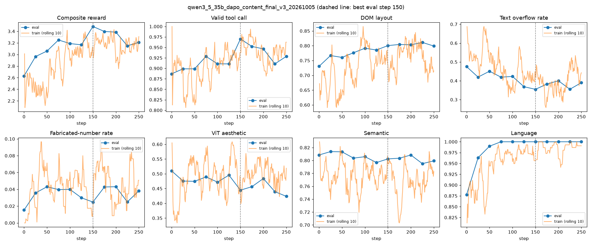
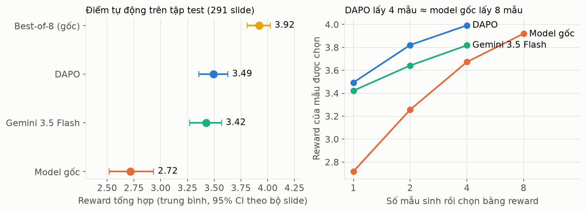
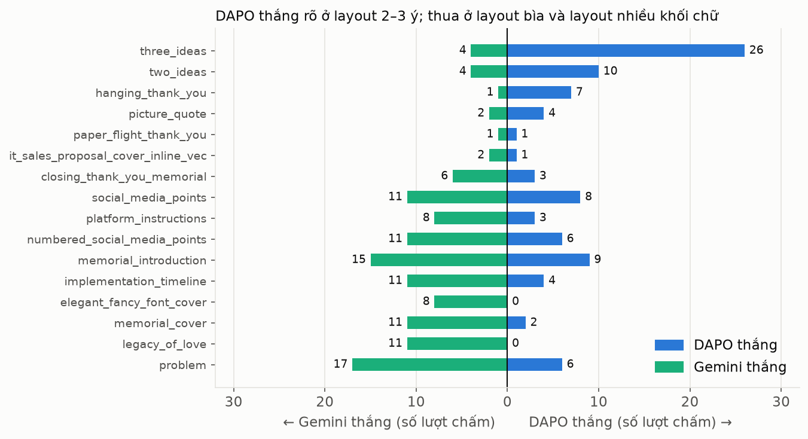
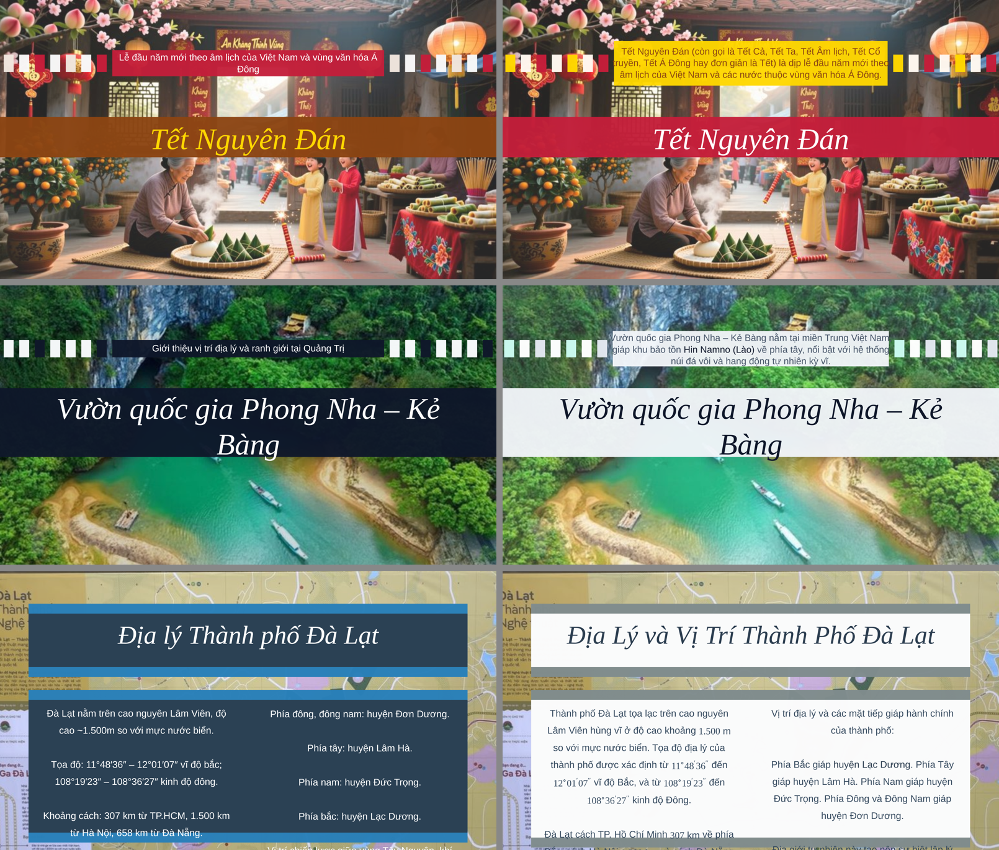

# Báo cáo: train DAPO cho SlideGen (Qwen3.5-35B-A3B)

Cập nhật: 13/10/2026. Vòng 1 đã xong (train, tập test, người chấm). Vòng 2 đang train.

## Tóm tắt

- **Xuất phát điểm:** bộ 1.929 cặp slide đẹp–xấu gán tay và reward model ViT train trên đó (chọn đúng 97,9%).
- **Bài toán:** model nhận nội dung một slide và sinh đúng một lời gọi công cụ XML để dựng slide. Mục tiêu là slide vừa đẹp vừa đúng nội dung.
- **Kết quả vòng 1:** DAPO tốt hơn model gốc theo cả điểm tự động lẫn người chấm, và tiệm cận Gemini 3.5 Flash. DAPO chưa thắng Gemini và chưa thắng cách "sinh 8 mẫu rồi lọc".
- **Phát hiện lớn nhất:** ba lần liên tiếp, lỗi tưởng là của model hóa ra là lỗi của môi trường train (công cụ, prompt, bước áp style). Sửa môi trường cho kết quả lớn hơn nhiều so với chỉnh thuật toán.
- **Đang làm:** train vòng 2 trên môi trường đã sửa lỗi màu chữ, với reward có thêm hai phép đo mới.

| Hệ thống | Reward tự động | Người chấm: DAPO thắng – thua (tổng thể) |
|---|---|---|
| Model gốc | 2.72 | 83 – 42 |
| **DAPO vòng 1** | **3.49** | – |
| Gemini 3.5 Flash | 3.42 | 53 – 75 |
| Best-of-8 (model gốc) | 3.92 | 35 – 54 |

---

## 1. Điểm xuất phát: dữ liệu gán tay và reward model thẩm mỹ

**Vấn đề.** Muốn dùng RL để model sinh slide đẹp thì cần một hàm chấm "đẹp hay xấu" chạy tự động hàng chục nghìn lần. Không có bộ dữ liệu slide nào có nhãn thẩm mỹ theo từng loại lỗi, và dùng LLM lớn để chấm thì quá chậm và đắt cho RL.

**Giải pháp.**
- **Tự dựng dữ liệu cặp đẹp–xấu bằng tay.** Mỗi cặp gồm một slide đẹp và một bản xấu của chính slide đó, mang một hoặc hai lỗi cụ thể được gán nhãn. Hai slide trong một cặp có cùng nội dung, chỉ khác ở lỗi, nên nhãn "bên nào đẹp hơn" là chắc chắn.
- **5 loại lỗi:** các khối đè nhau, cỡ chữ sai, màu nền xấu, màu chữ xấu, tràn chữ ra ngoài. 18 tổ hợp lỗi đơn và lỗi kép.
- **Quy mô:** 1.929 cặp từ 1.805 slide gốc, do 5 người làm.
- **Chia tập theo slide gốc**, cân bằng theo loại lỗi: 1.736 cặp train, 193 cặp kiểm thử, không có slide gốc nào nằm ở cả hai tập.
- **Train ViT-Base theo kiểu so cặp** (loss Bradley–Terry: `-log sigmoid(điểm_đẹp − điểm_xấu)`). Model cho mỗi slide một điểm số; reward thẩm mỹ là sigmoid của điểm đó.

**Kết quả.**

Trên 193 cặp chưa thấy, ViT chọn đúng slide đẹp 97,9%. Bộ cặp này dùng lại được theo hai cách: train reward model kiểu so cặp, hoặc làm benchmark đánh giá các bộ chấm thẩm mỹ khác.

**Insight.**
- Reward model rất tốt trên dữ liệu gán tay, nhưng slide do model sinh ra nằm ở vùng nó không chắc: điểm trung vị của slide sinh là −0,99, trong khi slide đẹp gán tay là +4,92 và slide xấu là −6,11. Vì vậy thẩm mỹ chỉ là một thành phần trong reward tổng hợp, không dùng một mình (mục 5 và 7).
- Reward model có học lỗi "màu chữ xấu": ở vòng 1 nó chấm gần 0 cho các slide bìa chữ trùng màu nền (mục 8). Tín hiệu có, nhưng bị các thành phần khác lấn át.

---

## 2. Hệ thống đã dựng

| Thành phần | Nội dung |
|---|---|
| Model | Qwen3.5-35B-A3B (35B tham số, ~3B kích hoạt mỗi token), QLoRA NF4, LoRA r16 |
| Thuật toán | DAPO (TRL `GRPOTrainer`), 4 mẫu mỗi prompt, LR 1e-5, early stopping |
| Reward | (0.5·lexical + 0.7·semantic + 1.0·numeric_fact + 1.5·dom + 1.0·ViT thẩm mỹ + 0.25·ảnh tải được) × hệ số ngôn ngữ; output hỏng = −2 |
| Đo bố cục (dom) | Render slide bằng trình duyệt thật, đo tràn chữ, đè chữ, vượt khung, lộ ký hiệu |
| Reward model thẩm mỹ | ViT pairwise ở mục 1 |
| Tập test | 38 bài Wikipedia tiếng Việt, 291 slide, chủ đề không trùng tập train, nội dung trích nguyên văn |
| Trang chấm người | https://slidegen-annotation.vercel.app, so cặp mù, 6 tiêu chí + 3 cờ lỗi |

---

## 3. Vấn đề 1: train quá chậm

**Vấn đề.** Mỗi bước train mất khoảng 166 giây, một lần train trọn vẹn mất hơn nửa ngày, không thể thử nhiều phương án.

**Giải pháp.** Dùng kernel tối ưu cho lớp linear attention của Qwen3.5 (flash-linear-attention, causal-conv1d), sửa lỗi tính gradient của kernel này trên GPU H100 bằng tilelang, và gom batch khi sinh mẫu.

**Kết quả.** Còn khoảng 60 giây mỗi bước (nhanh hơn 2,7 lần). Một lần train từ đầu đến lúc dừng sớm mất khoảng 6 giờ.

**Insight.** Nhờ nhanh hơn mới chạy được hơn 10 lần thử trong vài ngày, và chính các lần thử này làm lộ ra các lỗi môi trường ở mục 4.

---

## 4. Vấn đề 2: model "bịa số liệu", nhưng thủ phạm là môi trường

**Vấn đề.** Ở model gốc chưa train, 11,7% slide có số liệu, email hoặc số điện thoại không có trong nguồn.

**Giải pháp.** Không chỉnh thuật toán. Bóc tách từng slide lỗi thì thấy:
- Công cụ slide cảm ơn có sẵn giá trị mặc định cho số điện thoại, email, website, nên model để trống thì công cụ tự điền thông tin giả.
- Công cụ biểu đồ có số liệu mẫu mặc định; slide không có số liệu vẫn bị gán layout biểu đồ.
- Một gợi ý trong prompt khiến model viết sai ký tự thoát, làm hỏng JSON.

Sửa ba chỗ đó ở công cụ, schema và bước gán layout.

**Kết quả.**

**Insight.** Phần lớn "ảo giác" đo được là do môi trường tạo ra. Nếu train RL trên môi trường lỗi, model bị phạt vì thứ nó không điều khiển được, tín hiệu reward thành nhiễu.

---

## 5. Vấn đề 3: reward chưa đủ để nội dung "hoàn mỹ"

**Vấn đề.** Reward ban đầu chủ yếu thưởng thẩm mỹ. Model sinh slide tiếng Anh từ nguồn tiếng Việt, làm rơi mục trong timeline, để lộ ký hiệu định dạng, và lần eval ở bước 25 làm tràn bộ nhớ GPU.

**Giải pháp.**
- Thêm thành phần `numeric_fact`: thưởng giữ đúng số liệu của nguồn, phạt số liệu và thông tin liên hệ không có trong nguồn.
- Thêm hệ số ngôn ngữ dạng nhân: slide sai ngôn ngữ thì toàn bộ reward về gần 0.
- Chuyển điểm bố cục từ "sai là 0" sang phạt theo mức độ, để mỗi lỗi sửa được đều có tín hiệu.
- Sửa phép đo tràn chữ (trước đó báo sai 94% trường hợp).
- Tăng learning rate từ 1e-6 lên 1e-5 (ở 1e-6 LoRA gần như không đổi).

**Kết quả (run cuối vòng 1, tập eval lúc train).**

| Chỉ số | Model gốc | DAPO tốt nhất (bước 150) |
|---|---|---|
| Reward tổng hợp | 2.63 | **3.48** |
| Output hợp lệ | 0.887 | **0.970** |
| Tràn chữ | 0.475 | **0.355** |
| Đúng ngôn ngữ | 0.878 | **1.000** |
| Số liệu bịa | 0.015 | 0.025 |
| Thẩm mỹ (ViT) | 0.510 | 0.445 |

**Insight.** DAPO học nhanh các lỗi có tín hiệu rõ (hợp lệ, ngôn ngữ, tràn chữ). Sau bước 150 mọi chỉ số đi xuống, nên early stopping là cần thiết. Điểm ViT không tăng, và số liệu bịa không giảm thêm vì đã ở mức sàn sau khi sửa môi trường.

---

## 6. Vấn đề 4: đánh giá cũ không đủ tin cậy cho paper

**Vấn đề.** Tập eval lúc train chỉ có khoảng 18 chủ đề, trùng chủ đề với tập train, và chỉ có điểm của chính reward đã dùng để train.

**Giải pháp.**
- Dựng tập test mới từ Wikipedia: 291 slide, chủ đề tách biệt, có link và mã phiên bản từng bài.
- So bốn hệ thống trên cùng prompt, cùng layout, cùng renderer: model gốc, DAPO, Gemini 3.5 Flash, và best-of-8 (model gốc sinh 8 mẫu, reward chọn mẫu tốt nhất).
- Chấm người so cặp mù: 595 cặp, 3 người chấm, mỗi cặp ít nhất 2 người, có cặp lặp để kiểm tra chú ý.

**Kết quả tự động.**

| Hệ thống | Reward [95% CI] | Hợp lệ | Bố cục | Tràn ngang | Số liệu đúng |
|---|---|---|---|---|---|
| Model gốc | 2.72 [2.52, 2.93] | 0.887 | 0.807 | 8.5% | 0.813 |
| DAPO | 3.49 [3.36, 3.63] | 0.969 | 0.860 | 3.5% | 0.800 |
| Gemini 3.5 Flash | 3.42 [3.27, 3.57] | 0.962 | 0.718 | 33.6% | 0.868 |
| Best-of-8 | 3.92 [3.81, 4.02] | 0.997 | 0.893 | 5.9% | 0.897 |

**Kết quả người chấm (1.281 lượt, cả 3 người chấm đủ 100%).**

| So sánh (tổng thể) | Cặp | DAPO thắng | Hòa | DAPO thua | Tỉ lệ thắng [95% CI] |
|---|---|---|---|---|---|
| DAPO – model gốc | 254 | 83 | 129 | 42 | 0.565 [0.530, 0.598] |
| DAPO – Gemini | 168 | 53 | 40 | 75 | 0.458 [0.409, 0.506] |
| DAPO – best-of-8 | 145 | 35 | 56 | 54 | 0.456 [0.420, 0.495] |

**Insight.**
- **Chứng minh được:** DAPO hơn model gốc ở mọi loại slide. Lỗi sai ngôn ngữ do người đánh dấu giảm từ 11,9% xuống 3,6%.
- **Chứng minh được:** model mở sau DAPO tiệm cận Gemini 3.5 Flash. DAPO hơn về bố cục, ngang về thẩm mỹ, thua về độ đầy đủ nội dung.
- **Không chứng minh được:** DAPO thắng Gemini, và DAPO thắng best-of-8. Điểm sáng: DAPO lấy 4 mẫu đạt reward bằng model gốc lấy 8 mẫu, tức RL và lọc mẫu cộng dồn được.
- **Không có tín hiệu:** về độ trung thực. Người chấm chọn "ngang nhau" hơn 94% ở tiêu chí này.

DAPO thắng Gemini rõ ở layout 2–3 ý, thua ở layout bìa và layout nhiều khối chữ:

---

## 7. Vấn đề 5: reward có đáng tin không

**Vấn đề.** Toàn bộ việc train dựa vào reward. Nếu reward không phản ánh đánh giá của người thì model đang học sai mục tiêu.

**Giải pháp.** Dùng dữ liệu người chấm để kiểm tra: với mỗi cặp slide, reward có chọn cùng bên với người không.

**Kết quả.**

| Tiêu chí người chấm | Thành phần reward | Độ khớp |
|---|---|---|
| Tổng thể | Reward tổng hợp | 70,6% |
| Bố cục | dom | 84,6% |
| Thẩm mỹ | ViT | 66,7% |
| Đầy đủ | lexical / semantic | 65,0% / 62,3% |

**Insight.**
- Reward có nghĩa, và càng chắc khi hai slide chênh điểm càng lớn (100% khi chênh từ 2.0 trở lên).
- Học lại trọng số các thành phần từ dữ liệu người chấm không cải thiện gì (69,7% so với 70,2%). Trần 70% là do reward **thiếu tín hiệu**, không phải do cân sai trọng số.
- Người chấm quyết định chủ yếu theo thẩm mỹ và độ đầy đủ, trong khi reward đặt trọng số cao nhất cho bố cục và số liệu.
- Bộ đo bố cục bỏ sót 53 slide mà người thấy lỗi hiển thị.

---

## 8. Vấn đề 6: chữ trùng màu nền và chữ bị cắt ở mép slide

**Vấn đề.** Người chấm phản ánh lỗi nặng nhất là màu chữ khó đọc trên nền và chữ tràn viền. Reward không đo hai lỗi này.

**Chẩn đoán.** Lại là lỗi môi trường:
- Model chọn màu đúng (chữ trắng trên dải tối).
- Bước áp style của bộ slide ghi đè màu tiêu đề thành màu chủ đạo, trùng với màu dải nền.
- Pipeline thật có sẵn bước sửa tương phản ở khâu render cuối, nhưng đường train và đường chấm tập test bỏ qua bước này.

Hệ quả: mọi kết quả vòng 1, kể cả người chấm, đều đo trên slide chưa qua bước sửa màu. Cả ba hệ thống chịu chung điều kiện nên so sánh vẫn công bằng, nhưng đó không phải slide mà sản phẩm thật xuất ra.

**Giải pháp.**
- Nối bước sửa tương phản của pipeline thật vào đường reward.
- Thêm phép đo `low_contrast`: đo tương phản giữa màu chữ và pixel nền thật trên ảnh render, nên tính được cả nền là ảnh hay gradient.
- Thêm phép đo `text_cutoff`: chữ bị cắt ở mép slide.

**Kết quả.** 9/9 slide đầu tiên bị gắn cờ `low_contrast` đều đúng là không đọc được. Sau khi sửa, các slide từng hỏng đã đọc được (trái: DAPO, phải: Gemini):

Chấm lại toàn bộ output cũ của vòng 1 (mẫu đầu tiên, 291 slide mỗi hệ thống) trước và sau khi nối bước sửa màu:

| Hệ thống | Slide có chữ khó đọc: trước → sau | Thẩm mỹ (ViT): trước → sau | Chữ bị cắt ở mép | Reward mới |
|---|---|---|---|---|
| Model gốc | 17,7% → 0,4% | 0.49 → 0.59 | 12,4% | 2.76 |
| DAPO vòng 1 | 12,9% → 1,1% | 0.49 → 0.55 | 9,2% | 3.52 |
| Gemini 3.5 Flash | 12,5% → 0,4% | 0.51 → 0.57 | 19,3% | 3.40 |

Cột "trước" của lỗi chữ khó đọc đo trên các slide người đã chấm; các cột còn lại đo trên cả 291 slide.

Reward mới so với reward cũ, đối chiếu với đúng những slide người chấm đã xem ở vòng 1:

| Phép kiểm tra | Reward cũ | Reward mới |
|---|---|---|
| Slide người đánh dấu "lỗi hiển thị" mà bộ đo bố cục bắt được | 138/190 (73%) | **185/190 (97%)** |
| Điểm bố cục chọn trùng người ở tiêu chí bố cục | 84,6% | **89,9%** |
| Reward tổng hợp chọn trùng người ở tiêu chí tổng thể | 70,6% | 72,3% |

Hai phép đo mới gần như xóa hết phần bộ đo bố cục bỏ sót (còn sót 5 slide thay vì 52). Độ khớp ở tiêu chí tổng thể chỉ tăng nhẹ, còn trong khoảng sai số, vì người chấm quyết định tổng thể chủ yếu theo thẩm mỹ và độ đầy đủ. Bộ đo bố cục vẫn khắt khe hơn người: trong các slide nó báo lỗi, người chỉ đồng ý khoảng 47%.

**Insight.** Lỗi môi trường xuất hiện lần thứ ba (sau số liệu bịa và ký tự thoát). Đây là một luận điểm của paper: khi dùng RL cho bài toán gọi công cụ, phải kiểm tra môi trường train khớp với pipeline thật trước khi tin vào reward.

---

## 9. Đang chạy: train vòng 2

| Thay đổi so với vòng 1 | Lý do |
|---|---|
| Reward đi qua bước sửa tương phản của pipeline thật | Model không còn bị phạt vì màu do style gây ra |
| Phạt `low_contrast` (0.35) và `text_cutoff` (0.30) trong điểm bố cục | Hai lỗi người chấm thấy nhiều nhất mà reward cũ bỏ sót |
| Trọng số lexical 0.5 → 0.8 | Người chấm coi trọng độ đầy đủ; DAPO vòng 1 thua Gemini ở điểm này |

Mọi thiết lập khác giữ nguyên để so được với vòng 1. Thư mục run: `qwen3_5_35b_dapo_guard_20261013`.

---

## 10. Việc tiếp theo

1. **Chấm người vòng 2** trên slide của pipeline đã sửa, cho bảng kết quả chính của paper. Sửa giao thức chấm: bắt buộc chọn bên thắng ở tiêu chí tổng thể, đổi cách hỏi hai tiêu chí trung thực và đầy đủ (độ đồng thuận vòng 1 chỉ 0.13–0.14), đặt thời gian tối thiểu mỗi cặp.
2. **Nâng độ khớp ở tiêu chí tổng thể** (hiện 72,3%): cần tín hiệu thẩm mỹ và độ đầy đủ tốt hơn, vì hai phép đo bố cục mới chỉ giải quyết phần lỗi hiển thị.
3. **DAPO kết hợp lọc mẫu:** chấm người cho DAPO best-of-4 so với model gốc best-of-8.
4. **Tinh chỉnh ViT** bằng 192 cặp người chấm phân biệt được về thẩm mỹ, vì ViT hiện chỉ khớp người 66,7% trên slide do model sinh.
5. **Sửa layout bìa** trong thư viện: slide mở đầu bị gắn cờ lỗi hiển thị 35–44% ở cả ba hệ thống.
6. **Ablation model dense** (ví dụ Qwen3-8B) nếu muốn khẳng định lựa chọn kiến trúc A3B.

---

## 11. Hạn chế cần ghi trong paper

- Người chấm vòng 1 chọn "ngang nhau" rất nhiều (34–60% ở tiêu chí tổng thể), nên tỉ lệ thắng bị kéo về 0.5.
- Một người chấm làm rất nhanh (trung vị 8,8 giây mỗi cặp). Bỏ người này thì hướng kết quả không đổi.
- Tập train chỉ có 44 bộ slide, khoảng 18 chủ đề.
- Bảng điểm tự động dùng chính hàm mục tiêu lúc train, nên có lợi cho DAPO; kết quả chính phải là người chấm.
