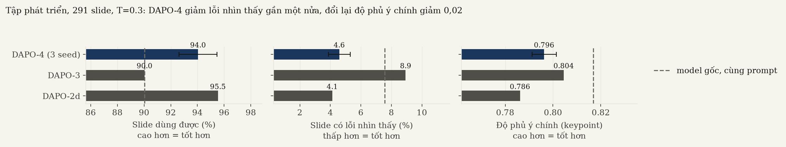

RESEARCH REPORT

# DAPO cho SlideGen: model mở tự dựng slide ít lỗi hiển thị hơn

Học tăng cường cho Qwen3.5-35B-A3B gọi công cụ XML dựng slide tiếng Việt, với reward kiểm chứng bằng người chấm

SlideGen · bản 2 · 2026.10

---

## Mục lục

01 · Tóm tắt
02 · Bối cảnh và bài toán
03 · Bước 1: dữ liệu cặp đẹp–xấu và reward model thẩm mỹ
04 · Bước 2: DAPO vòng 1 và đợt chấm người đầu tiên
05 · Bước 3: lỗi "của model" hóa ra là lỗi môi trường
06 · Bước 4: hiệu chỉnh reward bằng 820 slide người chấm, và các lần thử thất bại
07 · Bước 5: vòng 4, model học tóm gọn thay vì thu nhỏ chữ
08 · Bước 6: xem ảnh để vá các chỗ reward bị lừa
09 · Bước 7: tập test giữ riêng
10 · Kết luận
11 · Phụ lục

---

## 01 · Tóm tắt

DAPO trên Qwen3.5-35B-A3B giảm tỉ lệ slide có lỗi nhìn thấy từ 7,6% xuống 4,6% ± 0,7 (ba seed) trên tập phát triển và từ 4,7% xuống 3,0% trên tập test giữ riêng, và tỉ lệ slide dùng được tăng từ 90,0% lên 94,0% ± 1,4. Cái giá là độ phủ ý chính giảm 0,021 ± 0,005, vì model học tóm gọn để vừa layout chứ không thu nhỏ chữ. Người xem chưa được chứng minh là thích bản DAPO hơn (xác suất được chọn dự đoán 0,507 ± 0,008), và model gốc lấy best-of-4 đạt cùng mức với DAPO best-of-4.

Kết luận chính:

1. Bộ 1.929 cặp slide đẹp–xấu gán tay cho reward model ViT chọn đúng 97,9% trên cặp chưa thấy, ngang VLM 35B không train (97,4%) và vượt xa CLIP (47,9%) (Bước 1).
2. DAPO vòng 1 thắng model gốc khi người chấm: tỉ lệ thắng 0,565 [0,530; 0,598] trên 1.281 lượt chấm, nhưng thua Gemini 3.5 Flash (0,458) (Bước 2).
3. Ba lần liên tiếp, lỗi tưởng do model hóa ra do môi trường: số liệu bịa giảm từ 11,7% xuống 1,5% chỉ nhờ sửa công cụ và prompt, chưa train gì (Bước 3).
4. Phần lớn cải thiện đến từ môi trường và reward: lỗi nhìn thấy của chính model gốc giảm theo từng lần sửa; RL thêm phần ổn định và hợp lệ (Bước 3 đến Bước 6).
5. Trên tập test giữ riêng 337 slide, chạy một lần: slide dùng được 90,2% → 94,7%, lỗi nhìn thấy 4,7% → 3,0%. Nhưng model gốc sinh 4 mẫu rồi để reward chọn (best-of-4) đạt 97,0%, ngang DAPO best-of-4 (97,3%): RL tiết kiệm chi phí suy luận, không nâng trần chất lượng (Bước 7).

> **Báo cáo trả lời ba câu hỏi**
> RL có làm slide do model mở dựng ít lỗi hơn không, và có lặp lại qua nhiều seed không?
> Reward tự động có khớp với đánh giá của người không?
> Phần cải thiện đến từ RL hay từ việc sửa môi trường?

---

## 02 · Bối cảnh và bài toán

Model nhận nội dung một slide (đoạn trích từ tài liệu nguồn và layout được gán) rồi sinh đúng một lời gọi công cụ XML; công cụ dựng slide, trình duyệt render ra ảnh. Slide tốt phải vừa không lỗi hiển thị vừa giữ đủ ý của nguồn.

**Hiện trạng.** Model gốc Qwen3.5-35B-A3B trên tập phát triển: 97,6% lời gọi hợp lệ, nhưng 7,6% slide có lỗi người nhìn thấy được (chữ bị cắt, chữ khó đọc trên nền, khối đè nhau, chữ tràn khỏi nền).

**Vấn đề cốt lõi.**

> Không ai chấm tay được hàng chục nghìn slide trong lúc train. Reward phải tự động, mà reward tự động thì bị model khai thác ở đúng những chỗ nó đo sai. Mọi bước trong báo cáo là vòng lặp: đo, xem ảnh thật, tìm chỗ đo sai, sửa.

**Tiêu chí thành công.** Chỉ số chính là tỉ lệ slide dùng được, tức hợp lệ và không có lỗi nhìn thấy.

| Tiêu chí | Model gốc | Hiện tại (DAPO-4, 3 seed) | Mục tiêu | Khoảng cách |
|---|---|---|---|---|
| Slide dùng được (tập phát triển) | 90,0% | 94,0% ± 1,4 | ≥ 95% | 1,0 điểm (bản chốt: 95,2%, đạt) |
| Slide có lỗi nhìn thấy | 7,6% | 4,6% ± 0,7 | ≤ 4% | 0,6 điểm (bản chốt: 3,8%, đạt) |
| Độ phủ ý chính (keypoint) | 0,817 | 0,796 ± 0,005 | không thấp hơn gốc quá 0,03 | đạt |
| Người chọn DAPO hơn gốc (dự đoán) | 0,5 | 0,507 ± 0,008 | > 0,5 có ý nghĩa | chưa đạt |

**Dữ liệu.**

| Tập | Nguồn | Quy mô | Dùng để |
|---|---|---|---|
| Dữ liệu train RL | 44 bộ slide dựng sẵn, khoảng 18 chủ đề | 370 prompt | Train DAPO |
| Eval lúc train | Cùng phân phối với tập train | 168 slide × 4 mẫu | Early stopping |
| Tập phát triển | 38 bài Wikipedia tiếng Việt, chủ đề không trùng tập train | 291 slide | Chọn checkpoint, đo seed |
| Tập test giữ riêng (v2) | 44 bài Wikipedia mới, chủ đề không trùng hai tập trên | 337 slide | Chạy một lần duy nhất cho bản chốt |
| Người chấm vòng 1 | Trang so cặp mù trên Vercel, 3 người | 1.281 lượt, 595 cặp | Kiểm chứng reward |

Model: Qwen3.5-35B-A3B (35B tham số, khoảng 3B kích hoạt mỗi token), QLoRA NF4, LoRA r=16. Thuật toán: DAPO (DAPO: An Open-Source LLM Reinforcement Learning System at Scale, 2025) qua TRL `GRPOTrainer`, 4 mẫu mỗi prompt, LR 1e-5, early stopping theo reward eval. Giải thích thuật ngữ ở Phụ lục D.

---

## 03 · Bước 1

# Dữ liệu cặp đẹp–xấu gán tay cho reward thẩm mỹ chính xác 97,9%

Không có bộ dữ liệu slide nào gán nhãn thẩm mỹ theo loại lỗi, và LLM lớn chấm thì quá chậm cho RL. Chúng tôi tự dựng 1.929 cặp, mỗi cặp là một slide đẹp và một bản xấu của chính nó mang một hoặc hai lỗi cụ thể.

## Ý tưởng

- 5 loại lỗi: khối đè nhau, cỡ chữ sai, màu nền xấu, màu chữ xấu, chữ tràn ra ngoài; 18 tổ hợp lỗi đơn và kép; 1.805 slide gốc, 5 người làm.
- Chia tập theo slide gốc và cân bằng theo loại lỗi: 1.736 cặp train, 193 cặp kiểm thử, không slide gốc nào nằm ở cả hai tập.
- ViT-Base (An Image is Worth 16x16 Words, 2021) train kiểu so cặp với loss Bradley–Terry; reward thẩm mỹ là sigmoid của điểm.

## Kết quả

So với các bộ chấm không train trên cùng 193 cặp kiểm thử (`slidegen_data/pairs/baselines.json`):

| Bộ chấm | Khối đè nhau | Cỡ chữ sai | Màu nền xấu | Màu chữ xấu | Tràn chữ | Tổng |
|---|---|---|---|---|---|---|
| Ngẫu nhiên | 50% | 50% | 50% | 50% | 50% | 50% |
| CLIP ViT-B/32, zero-shot | 50,6% | 39,0% | 47,2% | 42,6% | 61,8% | 47,9% |
| Qwen3.5-35B-A3B (VLM), zero-shot, khử thiên lệch vị trí | 99,4% | 90,2% | 100% | 97,9% | 98,0% | 97,4% |
| ViT-Base train trên bộ cặp | 97,7% | 97,6% | 100% | 100% | 96,1% | 97,9% |

- CLIP zero-shot không phân biệt được (dưới mức ngẫu nhiên ở 3/5 loại lỗi).
- Một VLM 35B không train làm gần bằng ViT: lỗi tạo nhân tạo trong bộ cặp rõ ràng với model lớn. ViT chỉ hơn rõ ở cỡ chữ sai (97,6% so với 90,2%), nhưng nhỏ hơn và nhanh hơn rất nhiều, đủ để chấm hàng chục nghìn slide trong RL.
- Slide do model sinh nằm ở vùng ViT không chắc: điểm trung vị −0,99, giữa slide đẹp gán tay (+4,92) và slide xấu (−6,11). Vì thế thẩm mỹ chỉ là một thành phần của reward tổng hợp.

> **INSIGHT** Bộ cặp cùng nội dung, khác đúng một lỗi cho nhãn chắc chắn và đủ để train một reward nhỏ, nhanh, chính xác ngang VLM 35B. Nhưng nó không phải benchmark khó: VLM lớn không train đã đạt 97,4%. Phép thử khó là slide do model sinh có người chấm (Bước 2).

> **NEXT IDEA** Ghép ViT với các phép đo bố cục trên trình duyệt thật và các phép đo nội dung thành reward tổng hợp, rồi train DAPO.

---

## 04 · Bước 2

# DAPO vòng 1 thắng model gốc khi người chấm, nhưng chưa thắng Gemini

Reward tổng hợp gồm nội dung (từ vựng, ngữ nghĩa, giữ đúng số liệu), bố cục đo trong trình duyệt, ViT thẩm mỹ, nhân với hệ số đúng ngôn ngữ; lời gọi hỏng bị −2. Ba người chấm so cặp mù 595 cặp trên tập phát triển.

## Ý tưởng

- Tăng tốc train 2,7 lần (166 → 60 giây mỗi bước) bằng kernel flash-linear-attention và causal-conv1d, sửa gradient trên H100 bằng tilelang. Nhờ vậy chạy được hơn 10 lần thử.
- So bốn hệ thống cùng prompt, cùng renderer: model gốc, DAPO, Gemini 3.5 Flash, best-of-8 (model gốc sinh 8 mẫu, reward chọn mẫu tốt nhất).

## Kết quả

- DAPO thắng model gốc 0,565 [0,530; 0,598]; lỗi sai ngôn ngữ người đánh dấu giảm từ 11,9% xuống 3,6%.
- DAPO thua Gemini 0,458 [0,409; 0,506] và best-of-8 0,456 [0,420; 0,495]. DAPO lấy 4 mẫu đạt reward bằng model gốc lấy 8 mẫu.
- Reward tổng hợp chọn trùng người 70,6%, lên 100% khi hai slide chênh nhau từ 2,0 điểm reward; điểm bố cục khớp người 84,6%.

> **INSIGHT** Reward có nghĩa nhưng thiếu tín hiệu: học lại trọng số từ dữ liệu người không tăng độ khớp (69,7% so với 70,2%). Người chấm phàn nàn nhiều nhất về chữ khó đọc trên nền và chữ tràn viền, đúng hai lỗi reward không đo.

> **NEXT IDEA** Tìm vì sao reward bỏ sót hai lỗi này trước khi train tiếp.

---

## 05 · Bước 3

# Lỗi "của model" hóa ra là lỗi môi trường, ba lần liên tiếp

Bóc tách từng slide lỗi cho thấy nhiều lỗi model bị phạt là do công cụ, prompt hoặc bước áp style tạo ra. Train RL trên môi trường như vậy là phạt model vì thứ nó không điều khiển được.

## Ý tưởng

- Số liệu bịa: công cụ slide cảm ơn tự điền số điện thoại, email mẫu khi model để trống; công cụ biểu đồ có số liệu mẫu mặc định; một gợi ý trong prompt làm hỏng ký tự thoát JSON.
- Chữ khó đọc: model chọn màu đúng, nhưng bước áp style ghi đè màu tiêu đề thành màu dải nền. Pipeline thật có bước sửa tương phản ở khâu render cuối, đường train và đường chấm lại bỏ qua bước này.
- Thêm phép đo `low_contrast` trên pixel nền thật của ảnh render và `text_cutoff` cho chữ bị cắt ở mép slide.

## Kết quả

Nối bước sửa tương phản và hai phép đo mới: slide có chữ khó đọc của model gốc giảm từ 17,7% xuống 0,4%; bộ đo bố cục bắt được 185/190 slide người đánh dấu lỗi hiển thị, trước đó 138/190.

> **INSIGHT** Với RL gọi công cụ, phải kiểm tra môi trường train khớp với pipeline thật trước khi tin reward. Đây là một luận điểm của paper.

> **NEXT IDEA** Dùng chính dữ liệu người chấm để định trọng số các lỗi bố cục.

---

## 06 · Bước 4

# Hiệu chỉnh reward bằng 820 slide người chấm; các lần thử còn lại đều thất bại

Từ 342 cặp người chấm có kết quả rõ (820 slide), lỗi nào người xác nhận là lỗi hiển thị trong 73–90% trường hợp thì xóa toàn bộ điểm bố cục; tràn chiều cao khung chỉ mất một phần tư; các lỗi người không bao giờ đánh dấu riêng lẻ thì bỏ phạt.

## Ý tưởng

- Vòng 3: trọng số lỗi bố cục khớp người (lỗi nhìn thấy = 1,0; tràn chiều cao = 0,25; tràn chiều ngang và quá số dòng = 0).
- Thêm thành phần độ phủ ý chính (keypoint): mỗi câu nguồn có được thể hiện trên slide không. Khớp người ở tiêu chí đầy đủ 70,6%, hơn trùng từ vựng (65,0%) và ngữ nghĩa cả slide (62,3%).
- Gợi ý sức chứa đo bằng chính layout: chạy công cụ với chữ mẫu, tìm số ký tự dài nhất không tràn cho từng trường.

## Kết quả

Các thay đổi đơn lẻ thử trước khi có cấu hình vòng 4 đều không đạt, và được giữ lại như kết quả âm:

| Thử | Kết quả | Vì sao bỏ |
|---|---|---|
| Thêm câu "không bịa số liệu" vào prompt | Không đổi tỉ lệ bịa | Lỗi bịa chủ yếu do môi trường (Bước 3) |
| Nhắc escape dấu nháy JSON trong prompt | Không đổi tỉ lệ hợp lệ | Chuyển sang sửa ở bộ phân tích (Bước 6) |
| Gợi ý sức chứa v2 (đo đồng thời mọi trường) | Lỗi giảm một nửa trên máy chủ thử, nội dung và reward không tăng | Giữ cho vòng 4, không coi là cải tiến riêng |
| Vòng 2e: train tiếp từ 2d | Không hồi được độ phủ nội dung | Quay về LoRA mới cho vòng 4 |
| Tự co chữ ở layout | Lỗi nhìn thấy của model gốc 8,2% → 3,8% | Bỏ theo yêu cầu sản phẩm: cỡ chữ phải đồng nhất, model phải học tóm gọn |
| Đo độ chen chữ (khoảng cách giữa hai hộp chữ) | 78/262 slide sát nhau dưới 1 px, phần lớn bình thường | Không tách được slide lỗi |

> **INSIGHT** Thay đổi nào không qua được tập phát triển ở nhiệt độ 0,3 thì không đáng một lần train 6 giờ trên H100. Hầu hết được kiểm trên máy chủ Qwen ngoài hoặc trên output có sẵn trước.

> **NEXT IDEA** Vòng 4: LoRA mới, reward keypoint thay trùng từ vựng, gợi ý sức chứa v2, không tự co chữ.

---

## 07 · Bước 5

# Vòng 4: model học tóm gọn để vừa layout, lặp lại trên ba seed

Vòng 4 thay trùng từ vựng bằng độ phủ ý chính (trọng số 1,5), giữ nguyên cỡ chữ của layout, và dừng khi 3 mốc eval liền không vượt mức tốt nhất. Bản chốt là bước 175 của seed 42; hai seed lặp lại (7 và 2026) chạy trên đúng code đó.

## Ý tưởng

- Reward: 1,5·keypoint + 0,4·ngữ nghĩa + 0,7·số liệu + 2,1·bố cục + 1,5·ViT, nhân hệ số ngôn ngữ.
- Chọn bản chốt bằng cổng trên tập phát triển: hợp lệ ≥ 98%, dùng được ≥ 95%, lỗi nhìn thấy ≤ 4%, keypoint không thấp hơn gốc quá 0,03; trong các bản qua cổng lấy bản có xác suất người chọn dự đoán cao nhất.
- Đo lặp lại: hai seed thêm, đánh giá bản tốt nhất của từng seed trên tập phát triển với cùng bộ kiểm tra.

## Kết quả

- Chỉ bản chốt qua đủ cổng: dùng được 95,2%, lỗi nhìn thấy 3,8%, keypoint 0,791 (gốc 0,817). DAPO-2d hụt sát (lỗi nhìn thấy 4,1%, keypoint thấp hơn gốc 0,031); DAPO-3 hụt xa (lỗi nhìn thấy 8,9%).
- Chữ bị cắt giảm từ 2,7% xuống 1,0% ± 0,3. Ví dụ slide "Sức mạnh cốt lõi từ hạt Robusta" bị cắt chữ ở các mốc 150, 175 và 200 (mẫu lấy ở nhiệt độ 1,0), rồi ở bước 225 model tóm gọn đủ để vừa khung, reward 2,13 → 4,29.
- Ở nhiệt độ 0,3, phần lớn slide bìa và mục lục gần như giống hệt model gốc; khác biệt nằm ở slide nhiều chữ.

> **INSIGHT** RL làm slide ít lỗi hơn và ổn định qua seed, nhưng không làm nội dung hay hơn theo dự đoán của người. Seed ảnh hưởng mạnh đến thời điểm đạt đỉnh, nên early stopping theo eval là bắt buộc.

> **NEXT IDEA** Xem ảnh thật ở mỗi mốc để tìm chỗ reward chấm sai mà số liệu không lộ ra.

---

## 08 · Bước 6

# Xem ảnh thật tìm ra năm chỗ reward chấm sai

Mỗi mốc eval, ảnh mẫu được đặt cạnh mốc trước. Năm lỗi dưới đây có reward cao trong khi slide hỏng rõ ràng; mỗi bộ phát hiện chỉ được thêm sau khi kiểm trên hàng nghìn slide đã chấm và xem ảnh các ca bị gắn cờ.

## Ý tưởng

| Lỗi thấy trong ảnh | Ví dụ | Bộ phát hiện | Kiểm tra báo nhầm |
|---|---|---|---|
| Chữ có dấu bị hỏng | tiêu đề *"Cùng H Fle Ph^\i^^i^^n Kh^^o^^a"*, reward 5,16 | chữ^chữ hoặc ^^ | 0 trên 17.620 slide, kể cả công thức LaTeX |
| Chữ ngoại lai | *"Xuất khẩu خام Sang Tạo"*, *"trực tiếp指挥"* | thêm chữ Ả Rập, Do Thái, Devanagari | chỉ tính khi nguồn không có |
| Thẻ HTML lọt | *"<Vị đậm đà"*, `<math-field>` | "<" mở đầu một từ | mọi ca trên khoảng 15.000 slide là lỗi thật |
| Chữ tràn khỏi nền hoặc panel | tiêu đề cảm ơn tràn xuống ảnh tối; subtitle bị đẩy khỏi panel bìa | đo phần chữ vượt mép, xác nhận bằng pixel hai bên mép | bản chỉ đo DOM báo nhầm khoảng một nửa (nhãn trắng trên nền trắng); bản xác nhận pixel giữ mọi ca thấy rõ trên 20 slide xem tay |
| JSON hỏng vì dấu nháy lồng | *"Chiến dịch "nói không với rác thải nhựa""* | sửa dấu nháy khi phân tích, chỉ dùng khi đánh giá | dữ liệu đúng không đổi (51/51); mảng hỏng cấu trúc vẫn bị loại |

## Kết quả

- Bộ phát hiện tràn khỏi nền bản đầu gắn cờ 6–9% slide; xem ảnh thấy nửa số đó không nhìn thấy được. Sau khi xác nhận bằng pixel còn 1,7–3,1%.
- Sửa dấu nháy JSON đưa tỉ lệ hợp lệ của model gốc từ 97,9% lên 99,3% trên tập phát triển; bản chốt từ 99,3% lên 100%.
- Ở nhiệt độ 0,3, chữ ngoại lai, chữ hỏng và thẻ lọt đều bằng 0 ở mọi hệ thống; chúng chỉ xuất hiện khi lấy mẫu ở nhiệt độ 1,0 lúc train (khoảng 1% ở cả model gốc lẫn DAPO).

> **INSIGHT** Số liệu tổng hợp không lộ ra các lỗi này; chỉ xem ảnh mới thấy. Bộ phát hiện nào cũng phải kiểm tra báo nhầm bằng ảnh trước khi đưa vào reward.

> **NEXT IDEA** Chạy bản chốt đúng một lần trên tập test giữ riêng.

---

## 09 · Bước 7

# Tập test giữ riêng xác nhận DAPO giảm lỗi, nhưng best-of-4 của model gốc làm được như vậy

Bản chốt và model gốc chạy đúng một lần trên 337 slide của 44 bài Wikipedia chủ đề mới, cùng prompt, cùng bộ kiểm tra; ở nhiệt độ 0,3 một mẫu và ở nhiệt độ 1,0 bốn mẫu.

## Ý tưởng

- Kiểm tra kết luận trên tập phát triển ở dữ liệu chưa từng dùng để chọn bất cứ thứ gì.
- So với best-of-4 cùng chi phí lấy mẫu, câu hỏi reviewer sẽ hỏi đầu tiên: cần RL làm gì nếu lọc mẫu đã đủ.

## Kết quả

| Hệ thống (337 slide) | Reward | Hợp lệ | Dùng được | Lỗi nhìn thấy | Chữ bị cắt | Keypoint | Số liệu | ViT |
|---|---|---|---|---|---|---|---|---|
| Model gốc, T=0,3 | 3,597 | 95,0% | 90,2% | 4,7% | 1,5% | 0,811 | 0,826 | 0,599 |
| DAPO-4, T=0,3 | 3,715 | 97,6% | 94,7% | 3,0% | 0,6% | 0,788 | 0,798 | 0,579 |
| Model gốc, best-of-4, T=1,0 | 4,059 | 99,1% | 97,0% | 2,1% | 0,6% | 0,815 | 0,855 | 0,676 |
| DAPO-4, best-of-4, T=1,0 | 4,069 | 99,4% | 97,3% | 2,1% | 0,6% | 0,817 | 0,854 | 0,685 |

- Một mẫu ở T=0,3, DAPO tăng slide dùng được 4,5 điểm và giảm chữ bị cắt khoảng 2,5 lần; keypoint giảm 0,023, giống tập phát triển. Xác suất người chọn dự đoán 0,502 [0,486; 0,518].
- Có 21 slide khác trạng thái lỗi giữa hai hệ thống: 18 chỉ model gốc lỗi, 3 chỉ DAPO lỗi. Ví dụ 2001_06: model gốc đè chữ chín ban điện lực lên nhau, DAPO dựng 9 thẻ sạch.
- Best-of-4 xóa gần hết khác biệt: model gốc 97,0% so với DAPO 97,3% slide dùng được, reward 4,059 so với 4,069.
- 8 slide không hợp lệ của DAPO: 7 slide vượt số mục tối đa của layout (13 thẻ cho layout 3 thẻ), lỗi này model gốc cũng có với tần suất tương đương (4 so với 5 trên tập test).

> **INSIGHT** RL ở đây chuyển phần chất lượng của việc lọc 4 mẫu vào một mẫu duy nhất (rẻ hơn 4 lần khi suy luận), chứ không nâng trần chất lượng: khi được lọc, model gốc và DAPO ngang nhau.

> **NEXT IDEA** Người chấm phải trả lời phần còn lại: DAPO một mẫu so với model gốc một mẫu và so với model gốc best-of-4.

---

## 10 · Kết luận

DAPO giảm lỗi hiển thị một cách lặp lại được, nhưng phần lớn chất lượng đến từ việc sửa môi trường và reward.

**Kết luận chính**

1. Dữ liệu cặp đẹp–xấu gán tay cho reward thẩm mỹ nhỏ, nhanh, chính xác 97,9%, ngang VLM 35B không train; tập kiểm thử của nó quá dễ để làm benchmark cho model lớn.
2. Trên tập phát triển, DAPO-4 giảm lỗi nhìn thấy từ 7,6% xuống 4,6% ± 0,7 qua ba seed và tăng slide dùng được từ 90,0% lên 94,0% ± 1,4.
3. Đánh đổi: độ phủ ý chính giảm 0,021 ± 0,005 vì model tóm gọn để giữ nguyên cỡ chữ.
4. Chưa chứng minh được người xem thích bản DAPO hơn (0,507 ± 0,008 trên tập phát triển, 0,502 trên tập test).
5. Best-of-4 của model gốc ngang DAPO best-of-4 trên tập test (97,0% so với 97,3% slide dùng được): giá trị của RL là giảm chi phí suy luận, không phải nâng trần.
6. Ba lần lỗi môi trường và năm chỗ reward chấm sai đều chỉ lộ ra khi bóc tách từng slide và xem ảnh.

**Việc tiếp theo**

1. Chấm người đợt 2 trên pipeline đã sửa: bản chốt so với model gốc, model gốc best-of-4 và Gemini 3.5 Flash, khoảng 400 cặp không hòa mỗi so sánh. Bắt buộc chọn bên thắng ở tiêu chí tổng thể, đặt thời gian tối thiểu mỗi cặp.
2. Chạy lại Gemini 3.5 Flash trên tập test giữ riêng khi có key API mới.
3. Phạt thẩm mỹ thấp bằng phép nhân thay vì cộng: slide cảm ơn ghép 18 ô chữ nhỏ có ViT 0,07 nhưng reward tổng 5,04, cao hơn bản gọn 5 ô (4,94), vì điểm nội dung bù lại.
4. Sửa layout bìa và layout cảm ơn đang tự sinh lỗi ở mọi hệ thống: tiêu đề dài 3 dòng đè nội dung, hình trang trí đè chữ.

> **NEXT EXPERIMENT** Chấm người đợt 2 cho bản chốt so với model gốc, vì đó là câu hỏi duy nhất số liệu tự động không trả lời được.

---

## 11 · Phụ lục

### A. Bảng chi tiết

Tập phát triển, 291 slide, nhiệt độ 0,3, cùng prompt vòng 4, cùng bộ kiểm tra (sinh bằng `scripts/dev_eval_table.py` và `scripts/predicted_preference.py`, thư mục `slidegen_data/testset/scored_r4`).

| Hệ thống | Hợp lệ | Dùng được | Lỗi nhìn thấy | Chữ bị cắt | Tràn nền | Keypoint | Số liệu | ViT | Người chọn hơn gốc (dự đoán) |
|---|---|---|---|---|---|---|---|---|---|
| Model gốc | 97,6% | 90,0% | 7,6% | 2,7% | 3,1% | 0,817 | 0,822 | 0,581 | n/a |
| DAPO-2d | 99,7% | 95,5% | 4,1% | 1,4% | 1,7% | 0,786 | 0,804 | 0,558 | 0,501 [0,485; 0,519] |
| DAPO-3 | 99,0% | 90,0% | 8,9% | 3,1% | 3,4% | 0,804 | 0,824 | 0,544 | 0,494 [0,477; 0,513] |
| DAPO-4 seed 42 (bản chốt) | 99,0% | 95,2% | 3,8% | 0,7% | 2,7% | 0,791 | 0,789 | 0,598 | 0,509 [0,493; 0,524] |
| DAPO-4 seed 7 | 97,6% | 92,4% | 5,2% | 1,0% | 3,4% | 0,800 | 0,816 | 0,570 | 0,498 [0,485; 0,510] |
| DAPO-4 seed 2026 | 99,3% | 94,5% | 4,8% | 1,4% | 2,4% | 0,798 | 0,817 | 0,591 | 0,513 [0,500; 0,529] |

Người chấm vòng 1 (1.281 lượt): DAPO-1 so với model gốc 0,565 [0,530; 0,598]; so với Gemini 3.5 Flash 0,458 [0,409; 0,506]; so với best-of-8 0,456 [0,420; 0,495].

### B. Bài học đánh giá và hạn chế

- Tập phát triển đã dùng để chọn checkpoint và thiết kế bộ phát hiện, nên là tập phát triển chứ không phải tập test; kết quả độc lập chỉ có ở tập test giữ riêng (Bước 7).
- Xác suất người chọn là dự đoán của một hồi quy logistic fit trên 342 cặp người chấm vòng 1 (độ chính xác chéo khoảng 0,72), không phải người chấm thật.
- Eval nội bộ lúc train dùng 168 slide và lấy mẫu phụ thuộc seed: mức bước 0 dao động 3,90–4,18 giữa các seed, nên không so seed bằng eval nội bộ.
- Người chấm vòng 1 chọn "ngang nhau" rất nhiều (34–60% ở tiêu chí tổng thể); độ đồng thuận ở tiêu chí trung thực và đầy đủ chỉ 0,13–0,14.
- Tập train chỉ có 44 bộ slide, khoảng 18 chủ đề.
- Reward tự động là chính hàm mục tiêu lúc train nên có lợi cho DAPO; các chỉ số nhìn thấy được (cắt chữ, tràn nền) được kiểm bằng ảnh, còn kết luận về sở thích phải chờ người chấm.
- Lỗi thư viện: nạp lại checkpoint tốt nhất cuối run báo lỗi trong peft 0.19.1 (`WeightConverter ... distributed_operation`) sau khi train đã xong; các checkpoint không bị ảnh hưởng.

### C. Tài liệu tham khảo

- DAPO: An Open-Source LLM Reinforcement Learning System at Scale, 2025, arXiv:2503.14476.
- DeepSeekMath: Pushing the Limits of Mathematical Reasoning in Open Language Models, 2024, arXiv:2402.03300 (GRPO).
- An Image is Worth 16x16 Words: Transformers for Image Recognition at Scale, 2021, ICLR.
- QLoRA: Efficient Finetuning of Quantized LLMs, 2023, NeurIPS.
- LoRA: Low-Rank Adaptation of Large Language Models, 2022, ICLR.
- Rank Analysis of Incomplete Block Designs: I. The Method of Paired Comparisons (Bradley, Terry), 1952, Biometrika.

### D. Thuật ngữ

- DAPO - biến thể của GRPO: so điểm các mẫu cùng prompt để biết mẫu nào tốt hơn, không cần model giá trị.
- Hợp lệ - lời gọi công cụ phân tích được và công cụ chạy được.
- Lỗi nhìn thấy - chữ bị cắt, chữ khó đọc trên nền, khối đè nhau, lộ ký hiệu, vượt mép slide, chữ quá nhỏ, chữ tràn khỏi nền hoặc panel.
- Dùng được - hợp lệ và không có lỗi nhìn thấy.
- Keypoint - tỉ lệ câu của nguồn được thể hiện trên slide, đo bằng embedding đa ngôn ngữ.
- Best-of-N - sinh N mẫu, reward chọn mẫu tốt nhất.
- T=0,3 / T=1,0 - nhiệt độ lấy mẫu; 0,3 là thiết lập khi dùng thật, 1,0 là lúc train.
- Seed - hạt giống ngẫu nhiên quyết định thứ tự dữ liệu và việc lấy mẫu khi train.
