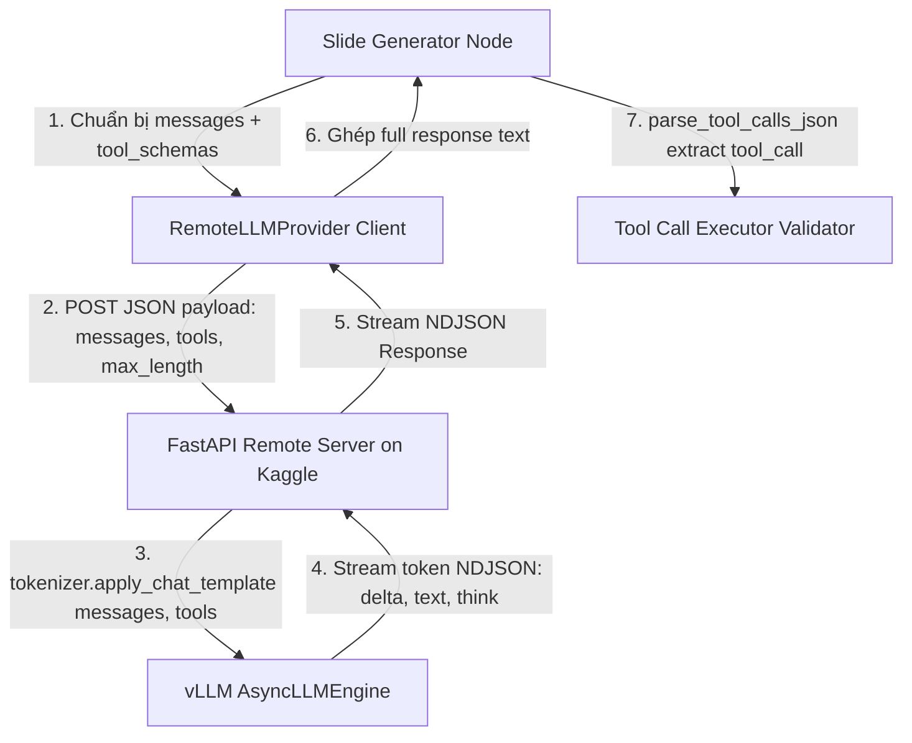

# 📋 Kế Hoạch Triển Khai Native Function Calling Cho Remote Qwen Models

Tài liệu này tổng hợp toàn bộ kế hoạch, kiến trúc và các bước cần thực hiện để chuyển đổi từ cơ chế **Prompt-based Tool Injection** (tự chèn text mô tả tool vào prompt) sang **Native Function Calling** (`tools=[...]`) chuẩn cho các mô hình Qwen (Qwen 3-8B / Qwen 3-14B AWQ).

---

## 1. 🎯 Mục Tiêu & Lợi Ích

- **Tiết kiệm Token & Context Window:** Không phải tự render hàng ngàn từ mô tả schema vào `System Prompt`.
- **Tăng độ chính xác (Tool Selection & Parameter Accuracy):** Model được học định dạng tool call chính thức qua Chat Template của Qwen (`<|im_start|>system\n# Tools...`), giúp giảm hiện tượng ảo giác tham số (`EXTRA_ARGUMENT`) và gọi sai tool (`UNKNOWN_TOOL`).
- **Giữ nguyên luồng Stream & CoT:** Vẫn đảm bảo tính năng streaming NDJSON mượt mà và khả năng suy luận chuỗi tư duy `<think>...</think>`.

---

## 2. 🏛️ Kiến Trúc Hệ Thống (Architecture Flow)



---

## 3. 📝 Chi Tiết Các Bước Cần Thực Hiện

### 🔹 Phần 1: Phía Server Host (`scripts/host_model.py`)

1. **Khởi tạo Tokenizer:**
   - Khai báo `AutoTokenizer.from_pretrained(LLM_MODEL_NAME, trust_remote_code=True)`.
2. **Cập nhật Schema `GenerateRequest` (Pydantic):**
   ```python
   class GenerateRequest(BaseModel):
       messages: Optional[List[Dict[str, Any]]] = None
       tools: Optional[List[Dict[str, Any]]] = None
       prompt: Optional[str] = None
       max_length: int = 1024
       temperature: float = 0.7
   ```
3. **Xử lý Chat Template tại endpoint `/generate`:**
   - Nếu nhận được `messages` và `tools`:
     ```python
     final_prompt = tokenizer.apply_chat_template(
         req.messages,
         tools=req.tools,
         tokenize=False,
         add_generation_prompt=True
     )
     ```
   - Nếu chỉ nhận chuỗi `prompt: str` thuần: giữ nguyên `final_prompt = req.prompt` để tương thích ngược.
4. **Đưa vào `vLLM AsyncLLMEngine`:**
   - Chạy `engine.generate(final_prompt, sampling_params, request_id)` và tiếp tục stream NDJSON như hiện tại.

---

### 🔹 Phần 2: Phía Client Provider (`backend/infrastructure/llm_providers/base.py`)

1. **Cập nhật `generate_completion` trong `RemoteLLMProvider`:**
   - Nhận cả 2 tham số: `messages` (dạng List[Dict]) và `tools` (dạng List[Dict] JSON Schema).
   - Đóng gói vào `payload` gửi sang server:
     ```python
     payload = {
         "messages": messages if isinstance(messages, list) else None,
         "prompt": messages if isinstance(messages, str) else None,
         "tools": tools,
         "max_length": max_tokens,
         "temperature": temperature,
     }
     ```

---

### 🔹 Phần 3: Phía Node Sinh Slide (`backend/workflows/slidegen_workflow/nodes/slide_generator.py`)

1. **Chuẩn hóa danh sách Tool Schema:**
   - Chuyển đổi danh sách `generator_tools` sang format Function Calling của Qwen:
     ```python
     tool_schemas = [format_tool_for_qwen(t) for t in generator_tools]
     ```
2. **Làm gọn System Prompt:**
   - Loại bỏ hàm nối text dài dòng `_build_tool_description_text(tool_schemas)`.
   - Giữ lại các chỉ dẫn thiết kế cốt lõi và quy tắc CoT trong `System Prompt`.
3. **Gửi sang LLM:**
   - Truyền `messages` và `tools=tool_schemas` vào `llm.generate_completion(...)`.
4. **Bóc tách kết quả (Parser):**
   - Giữ nguyên hàm `parse_tool_calls_json(content)` hiện tại (đã hỗ trợ bóc tách hoàn hảo `<tool_call>...` và `<think>...`).

---

## 4. 🔍 Kế Hoạch Kiểm Thử (Verification Plan)

| Bước | Nội dung kiểm tra | Kết quả mong đợi |
| :--- | :--- | :--- |
| **Test 1** | Chạy script kiểm tra đơn lẻ `scripts/test_remote_api.py` có truyền `tools=[...]` | Server phản hồi stream mượt mà, trả về đúng cú pháp tool call của Qwen. |
| **Test 2** | Chạy thử 1 sample slide: `python scripts/test_generator_executor_loop.py --sample 0 -v` | Generator chọn đúng tool, không bị lỗi cú pháp, Executor validate thành công. |
| **Test 3** | Chạy benchmark 50 samples: `python scripts/test_generator_executor_loop.py --start 0 --end 49` | Đo lường tỷ lệ Pass Rate và kiểm tra lỗi `EXTRA_ARGUMENT` có giảm đáng kể hay không. |

---

> [!TIP]
> Tài liệu này đã được lưu vào hệ thống để bạn có thể xem lại bất kỳ lúc nào mà không sợ bị trôi thông tin trong luồng hội thoại!
